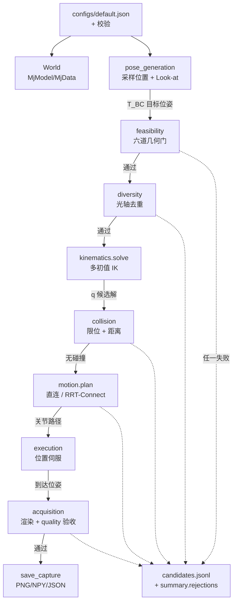
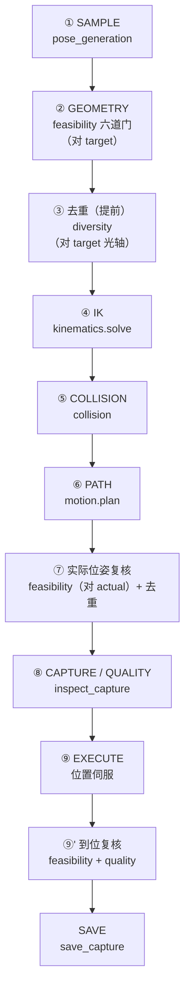

# 代码学习指南

这份文档的目标不是「列出每个函数做什么」，而是让你建立一套**能自己读下去的心智模型**。读完你应该能回答：

- 改一个配置项，会影响哪几个模块、哪几个产物字段？
- 一个视点被拒绝，原因是在哪一行决定的、记录在哪里？
- 为什么改一处代码不会让历史上所有数据失效？
- 输出的 `views.json` 里某个数字，是哪一行算出来的？

配套文档：`docs/simulation_architecture.md` 讲**实现机制**（建模、渲染、碰撞的细节），本文讲**怎么学**、**概念怎么串**、**怎么动手验证**。要上真机时读 `docs/real_robot_bringup.md`（标定、单位、符号、限位各自的实测影响）。三者交叉阅读。

---

## 0. 这份文档怎么用

### 建议的阅读节奏

| 遍 | 目标 | 花多久 | 做什么 |
|---|---|---|---|
| 第 1 遍 | 建立全局图 | 30 分钟 | 只读 §1–§4，不打开代码。目标是能背出「三层架构 + 九道门」 |
| 第 2 遍 | 跟着数据走 | 1 小时 | 读 §5 第 1–3 组，同时打开 `planner.py` 逐行对照 |
| 第 3 遍 | 深入单点 | 2 小时 | 选 §5 中你最关心的 1–2 组精读，配合 §7 的实验动手做 |
| 第 4 遍 | 能改 | 持续 | 用 §8 的坑位清单 + §9 的调试路线图，改配置、加功能 |

**关键建议：不要按文件名字母序读。** 这个工程的模块有明确的依赖层次，按层次读才不会在 `planner.py` 里迷路。

### 一句话概括这个工程

> 在一个 MuJoCo 工位里，随机采样相机位置、用 Look-at 定朝向、经九道门筛掉不可用的视点，把通过的视点用位置伺服真正执行一遍，再渲染 RGB-D 与实例掩码落盘——全程由单一随机种子决定，任何一次运行都能逐字节复现。

---

## 1. 全局图

### 1.1 数据流（一次 `run` 的完整路径）



注意虚线：**每一个失败点都汇入同一份拒绝统计**。这是理解整个工程的关键——它不只是「产出数据」，更是「可解释地产出数据」。

### 1.2 三层架构（最重要的一张图）

```mermaid
graph LR
    subgraph pure["纯算法层（不 import mujoco）"]
        geometry
        pose_generation
        feasibility
        diversity
        quality
        run_statistics
        kinematics
        config
        motion
    end
    subgraph adapter["引擎适配层"]
        model_builder
        collision
        execution
        world
    end
    subgraph orch["编排层"]
        acquisition
        planner
        comparison
        report
        cli
        playback
    end
    pure --> adapter --> orch
```



**怎么用这张图**：

- 想知道「这个计算能不能脱离仿真器单测」→ 看模块在哪一层。纯算法层全部可以，`tests/test_mujoco_workcell.py` 里的 `GeometryAndConfigTests` 就是这么做的。
- 想加一个几何约束 → 加到 `feasibility`（纯层），不需要建模型。
- 想知道哪一层最难改 → 适配层。`world.py` 是唯一持有 `MjModel`/`MjData` 的地方，改动风险最高。

**验证方法**（你现在就可以跑）：

```bash
grep -rn "import mujoco" viewpoint_sim/
# 应该只有 4 个文件：world.py, collision.py, execution.py, cli.py
```

如果某个「纯算法」模块里出现了 `import mujoco`，那说明分层被破坏了。

### 1.3 模块清单（按依赖层次排序，这是推荐阅读顺序）

| # | 模块 | 行数 | 层 | 一句话 | 前置依赖 |
|---:|---|---:|---|---|---|
| 1 | `config.py` | 47 | 纯 | 装载 + 校验配置，算安装外参 | geometry |
| 2 | `geometry.py` | 133 | 纯 | 变换、投影、多边形、裁剪 | scipy.Rotation |
| 3 | `pose_generation.py` | 115 | 纯 | 平面采样 + 高度 + Look-at | geometry |
| 4 | `feasibility.py` | 140 | 纯 | 六道几何门 | geometry |
| 5 | `diversity.py` | 63 | 纯 | 光轴去重与夹角统计 | geometry |
| 6 | `quality.py` | 128 | 纯 | 图像验收（可见率/深度/构图） | — |
| 7 | `run_statistics.py` | 81 | 纯 | `summary.json` 契约 | diversity |
| 8 | `kinematics.py` | 86 | 纯 | URDF FK + 雅可比 + 多初值 IK | geometry, scipy |
| 9 | `motion.py` | 78 | 纯 | 插值 + 碰撞边检查 + RRT-Connect | — |
| 10 | `model_builder.py` | 145 | 适配 | URDF + 配置 → MJCF 字符串 | config |
| 11 | `collision.py` | 111 | 适配 | 待检对构造 + 距离查询 | mujoco |
| 12 | `execution.py` | 154 | 适配 | 两条执行循环 + 稳定判据 | mujoco, motion |
| 13 | `world.py` | 186 | 适配 | MuJoCo 实例：渲染、掩码、装配 | 上述全部 |
| 14 | `acquisition.py` | 66 | 编排 | 渲染 → 验收 → 落盘 | world, quality |
| 15 | `planner.py` | 147 | 编排 | 主流程九道门 | 全部 |
| 16 | `comparison.py` | 31 | 编排 | 同 XY 的平移 vs 重 Look-at 对照 | feasibility |
| 17 | `report.py` | 35 | 编排 | 零依赖离线 HTML | — |
| 18 | `cli.py` | 162 | 编排 | 子命令入口 | 全部 |
| 19 | `playback.py` | 352 | 编排 | 回放控制状态 + Tk 控件窗 | — |

合计 `viewpoint_sim/` **2267 行 / 21 个文件**。加上测试 298 行、脚本 70 行，全工程 2635 行。

**注意 `playback.py` 是最大单文件（352 行）却几乎独立** —— 它只被 `cli.replay` 用到，与主数据流完全解耦。学习时可以整段跳过。

---

## 2. 必须先建立的四个心智模型

这四点是全工程的地基。不先建立它们，读代码会不断困惑。

### 2.1 模型一：`T_AB` 的语义

全工程唯一使用的位姿表示是 **4×4 齐次矩阵**，命名规则固定：

```
T_AB   把 B 坐标系下的点，变到 A 坐标系下
```

于是：

- `T_BC`：相机 → 基坐标（这是「相机在哪、朝哪看」）
- `T_BF`：法兰 → 基坐标（这是「机械臂末端在哪」）
- `T_FC`：相机 → 法兰（这是「相机怎么装在手上的」，运行期恒定）

三者关系是一条链：

```
T_BC = T_BF · T_FC          ← 正算：知道机械臂姿态求相机位姿
T_BF = T_BC · T_FC⁻¹        ← 反算：知道想要的相机位姿求机械臂该去哪
```

**反算那一行就是 `planner.py` 的核心一行**：

```python
solutions = world.kin.solve(target@inv(world.mount), current, ik_rng, cfg["robot"])
#                              ↑ T_BC · T_FC⁻¹ = T_BF
```

**为什么必须理解这个**：`planner` 里四处位姿互换（`target`/`actual`、`T_BC`/`T_BF`、`flange_pose()`/`camera_pose()`），如果你不能在大脑里追踪这些变换链，会读得极其痛苦。

**验证**（`tests/test_mujoco_workcell.py` 已经做了）：

```python
test_mujoco_fk_matches_official_urdf:
    np.testing.assert_allclose(w.camera_pose(), w.flange_pose() @ w.mount, atol=1e-9)
```

### 2.2 模型二：光心 ≠ 法兰，且轴向有两套约定

三个容易混淆的「相机」：

| 名称 | 代码里是什么 | 用在哪 |
|---|---|---|
| **光心**（optical centre） | `T_BC` 的平移部分，即相机主点 | 采样、投影、几何门、落盘 |
| **法兰**（flange） | `T_BF`，机械臂 `link6` 坐标系 | IK 求解、执行、碰撞 |
| **MuJoCo 相机** | `data.mocap_pos/quat` 驱动的虚拟相机 | 仅渲染 |

**两套轴向约定**：

| 领域 | X | Y | Z |
|---|---|---|---|
| 几何/投影（OpenCV 风格） | 右 | **下** | 前 |
| MuJoCo 相机 | 右 | **上** | **−前** |

它们差一个 180° 绕 X 的旋转。转换就在 `world._camera()` 里：

```python
R = T_BC[:3,:3] @ np.diag([1,-1,-1])     # ← 这一行就是全部魔法
```

**为什么这件事重要**：如果你自己写一个「相机在 x 方向偏移」的调试代码，用错了约定就会得到上下颠倒的图。这个 180° 是 `tests/test_mujoco_workcell.py::test_rgb_depth_and_segmentation_are_aligned` 在守的（中心像素深度必须 ≈ 0.36 m）。

### 2.3 模型三：九道门流水线

一个候选视点要依次通过（`planner.run()` 的实际顺序）：



**三个必须记住的设计要点**：

1. **排序 = 从便宜到贵**。去重是一次点积；IK 是毫秒级；路径规划最坏 278 ms；渲染 3 次（RGB + 深度 + 分割）。先做便宜的，能省掉后面的全部代价。这就是为什么「去重」出现在 IK **之前**。
2. **同一个检查会做两遍**（②/⑦、⑧/⑨'）。原因不同：
   - ②→⑦：`target` 是「我想去哪儿」，`actual` 是「IK 解真的能到哪儿」，两者差 0.1 mm 级，但几何指标是连续量，「刚好过」的位姿可能在实际位姿上失败。
   - ⑧→⑨'：`set_q` 是瞬移，位置伺服是真实执行，差 0.1 mm 级同样的问题。
3. **⑨' 的失败会推进 `current`**。这是一个反直觉但正确的地方——见 §8 的坑 #4。

**实测这道流水线的漏斗**（`outputs/demo`）：

```
68 次尝试 → 12 次接受（17.6%）
  261mm  层: 13 次尝试  拒绝 ik_or_singularity 2, food_out_of_rgb_fov 7
  360mm  层: 19 次尝试  拒绝 ik_or_singularity 12, duplicate_axis 3
  420mm  层: 36 次尝试  拒绝 ik_or_singularity 26, duplicate_axis 4, depth_range 2
```

这里是**当前配置**（基座后移 140 mm、侧壁顶 0.38 m、最低高度 261 mm）的实测。
换成更宽松的场景，或把 `heights_above_tray_m` 调回 300/360/420 并让基座回原位，
漏斗会几乎不过滤（旧基线下 12 次尝试 12 次接受）。**漏斗的松紧由场景决定，不是定值。**

要单独看某一道门起作用，`configs/jitter_and_crop.json` 是更小的例子（8 次尝试，
6 次 `ik_or_singularity`）。

### 2.4 模型四：确定性 = 四条独立随机流

`planner.py` 第 30 行是整个可复现设计的核心：

```python
seeds = np.random.SeedSequence(cfg["seed"]).spawn(4)
sample_rng, ik_rng, path_rng, jitter_rng = [np.random.default_rng(k) for k in seeds]
```

**为什么要拆成四条？** 因为如果共用一条流：

```
改动前：sample → ik → ik → path → sample → ik ...
改动后：sample → ik → ik → ik → path → sample → ...   （IK 多试了一次）
                                      ↑ 后面所有 XY 采样全部错位
```

一个「让 IK 多试一个初值」的小改进，会让**历史上所有数据都无法复现**。拆成四条后：

- 改 IK → 只影响 `ik_rng`，XY 序列完全不变；
- 改 RRT 参数 → 只影响 `path_rng`；
- 改采样逻辑 → 只影响 `sample_rng`。

**还有一个反向的坑**：`jitter_rng` 在 `z_jitter_m == 0` 时**一次都不消费**：

```python
def sample_z_perturbation(cfg, rng):
    amplitude = float(cfg["sampling"]["z_jitter_m"])
    if amplitude <= 0.0:
        return 0.0          # ← 提前返回，不调用 rng.uniform
    return float(rng.uniform(-amplitude, amplitude))
```

这不是性能优化，而是**为了保持历史种子可复现**：早期运行 `jitter` 从不存在，如果现在无条件抽一次随机数，`jitter_rng` 就没什么可保护的（它独立），但**抽取顺序变了会让代码看起来在「做同一件事却给出不同结果」**，破坏「Δ=0 等价于没有扰动」这个不变式。

**验证方法**：

```bash
# 同样的种子、同样的配置 → 逐字节一致（除两个时间戳字段）
rm -rf /tmp/a /tmp/b
.venv/bin/python -m viewpoint_sim run --config configs/default.json --output /tmp/a --headless
.venv/bin/python -m viewpoint_sim run --config configs/default.json --output /tmp/b --headless
diff <(sed 's/"created_utc".*//' /tmp/a/summary.json) <(sed 's/"created_utc".*//' /tmp/b/summary.json)
```

---

## 3. 配置是唯一的契约

**这是理解本工程最省力的一条捷径**：几乎所有的「魔法数字」都在 `configs/default.json` 里，代码只是读它。所以：

> 想知道某个行为为什么是这样 → 先查配置，再看代码。

### 3.1 配置块与对应模块

| 配置块 | 谁在用 | 决定什么 |
|---|---|---|
| `robot` | `kinematics`, `collision`, `model_builder` | 机型、home 姿态、IK 容差、限位裕量、奇异判据 |
| `camera` | `feasibility`, `world`, `acquisition`, `model_builder` | 内参、深度量程、安装外参、夹具尺寸 |
| `roi` | `feasibility`, `pose_generation`, `acquisition` | 食材包围盒、托盘面高与四角 |
| `sampling` | `pose_generation`, `feasibility`, `diversity`, `planner` | 采样范围、高度层、每层目标数、倾角/去重/边距阈值、Z 扰动 |
| `motion` | `motion`, `collision`, `execution`, `cli` | 碰撞裕量、路径分辨率、RRT 参数、执行模式、伺服与稳定判据 |
| `quality` | `quality` | 可见率/深度有效率/像素数阈值、裁剪内边距 |
| `postprocess` | `acquisition` | 裁剪开关与内边距 |
| `scene` | `model_builder` | 桌子、托盘、障碍、食材、烤箱 |
| `seed` | `planner` | 全部随机性的根 |

### 3.2 一个配置项如何传导到产物

以 `sampling.min_axis_angle_deg = 6`（最小光轴夹角）为例，完整传导链：

```
configs/default.json
  └─ diversity.is_duplicate()      比较 angle_deg(axis, known) < 6
       ├─ planner 第 57 行          对 target 光轴 → 早期拒绝
       └─ planner 第 80 行          对 actual 光轴 → 实际拒绝
            └─ 拒绝原因 "duplicate_axis"
                 ├─ summary.json → heights[i].rejections["duplicate_axis"]
                 ├─ candidates.jsonl → 该尝试的 reason 字段
                 └─ report.html → "候选拒绝原因" 柱状图
```

**练习**：自己挑一个配置项，把这条链走一遍。最快的办法是 `grep -rn "min_axis_angle_deg" viewpoint_sim/`。

### 3.3 配置校验：`config.validate_config`

`config.py` 有 20 多行校验，**它们不是可有可无的防御**，而是把「配置错了」和「算法错了」区分开。例如：

```python
if len(s['tray_min_ratio_by_height']) != len(s['heights_above_tray_m']):
    raise ValueError('One tray threshold is required per height')
```

如果不校验，`tray_threshold(cfg, height_index)` 会静默地 `IndexError` 或读到一个错误的值 —— 后者更糟，因为**静默地关闭了一道门**。

**做实验**：把 `tray_min_ratio_by_height` 删掉一项，看报错信息。这也是 `config.py` 值得先读的原因——它用 47 行告诉了你整个配置的合法形状。

---

## 4. 产物逐层解读

知道**输出什么**，才能反推**代码在做什么**。

### 4.1 目录结构

```
outputs/demo/
├── config.json            运行快照（在任何计算之前写，便于事后复现）
├── candidates.jsonl       每次尝试一行（含被拒的）
├── views.json             被接受的视点，完整记录
├── summary.json           汇总统计
├── height_comparison.json 受控对照实验（平移 vs 重 Look-at）
├── report.html            自包含离线报告
├── h00_c0001/             每个接受的视点一个目录
│   ├── rgb.png            uint8 RGB
│   ├── depth_mm.png       uint16 毫米，0 = 无效
│   ├── depth_z_m.npy      float32 米，**范围过滤前**的原始值
│   ├── instance.png       uint16，0=背景，1..N 按 scene.foods 顺序
│   ├── food_mask.png      uint8 二值（0/255），从 instance>0 派生
│   ├── overlay.png        RGB + 三色叠加框
│   ├── overview.png       第三人称工位图
│   └── metadata.json      该视点的完整元数据
└── crop_*.png             仅 crop_mode="tray_roi" 时存在
```

### 4.2 三个深度文件的区别（最容易搞错）

| 文件 | dtype | 单位 | 无效值 | 是否过滤 |
|---|---|---|---|---|
| `depth_mm.png` | uint16 | 毫米 | `0` | **已过滤**（超量程写 0）|
| `depth_z_m.npy` | float32 | 米 | 保留原值 | **未过滤** |
| `views.json` 里无深度 | — | — | — | — |

**为什么要两个**：`depth_mm.png` 是给下游消费的（标准 uint16 深度图），但过滤是**不可逆的**——超量程的真实值被抹成 0 了。要检查「到底有多少像素超出量程」或者重新调阈值，必须用 `depth_z_m.npy` 的原始值。这也是 `geometry.roi_depth_min_m` / `roi_depth_max_m` 能被复算的前提。

### 4.3 `views.json` 一个记录的四组位姿

这是最值得反复看的数据结构。每个视点记录同时保存：

```
目标 vs 实际：
  T_BC_target   T_BC_actual     相机位姿（几何门用的是这两个）
  T_BF_target   T_BF_actual     法兰位姿（IK 与执行用的是这两个）
恒定外参：
  T_FC                          相机在法兰上的安装
关节：
  q_target_rad  q_actual_rad    两者相差 = 伺服误差
  path_q_rad                    实际走过的路径
误差指标：
  camera_position_error_m       位置偏差（米）
  camera_rotation_error_deg     旋转偏差（度）
  ik.scaled_jacobian_sigma_min  离奇异的距离
执行统计：
  execution.physics_steps       物理步数
  execution.arrived_joint_error_rad
```

**为什么存四组而不只存最终位姿**：为了让任何一次采集都能回答「当时以为在哪」和「实际在哪」。代价是 `views.json` 有 80 KB / 12 个视点。

**实测误差**（`outputs/demo`）：

```
camera_position_error_m      最大 0.141 mm
camera_rotation_error_deg    最大 0.023°
```

远小于容差（0.5 mm / 0.1°）。这说明位置伺服在这个工况下几乎精确到位。

### 4.4 `summary.json` 的三个约定

`run_statistics.py` 刻意保持的、会影响落盘字节的不变式：

1. **`heights` 按配置顺序**，不是按接受顺序。所以 `summary.heights[0]` 永远是 300 mm（如果配置里排第一）。
2. **`rejections` 统计每一次被拒尝试**。一个高度试了 12 次才凑够 4 个，会报告全部 12 次的原因。
3. **`view_ids_ranked_by_tray_ratio` 只做事后排序**，不参与选择。选择策略仍是「先通过先接受」。

**为什么这些约定要写进文档**：它们是**文件格式的一部分**。改动它们会让所有历史数据「看起来还是那样但其实定义变了」。

### 4.5 `candidates.jsonl` 为什么是 JSONL

两个硬理由：

1. **每行结构不同**。4 种形状：

| 情况 | 额外字段 |
|---|---|
| 接受 | `folder` `tray_ratio` |
| 早期拒绝（几何/去重/IK） | 无 |
| 碰撞拒绝 | `collision_detail` |
| 捕获后质量拒绝 | `capture_failures` `quality` |
| 到位后拒绝 | `moved` `q_start_rad` `q_end_rad` `path_q_rad` |

如果用 JSON 数组，就得给所有行补齐并集字段、填满 `null`。而「一个被几何门拦掉的尝试本来就沒有 `collision_detail`」——这不是省事，是语义正确。

2. **可以边跑边追加**。JSON 数组不能 append（要改文件末尾的 `]`），JSONL 一次 `write` + 换行即可。这就是代码里 `log.flush()` 的用途：跑到一半崩溃，前面所有行仍然完好。

**注意：目前没有任何代码读它**。它纯粹是给人/外部工具看的诊断产物。

### 4.6 `metadata.json` 与 `views.json` 的关系

同一份记录，两种组织：

- `views.json` = 一个数组，全部 12 个视点的完整记录（80 KB）；
- `h00_c0001/metadata.json` = 单个视点的记录（含 `labels_definition` 等自描述字段）。

`save_capture` 会**追加**图像相关字段（`crop_mode`、`crop_bbox_xyxy`、`K_crop`、`tray_ratio_cropped`）到 `record`，然后把同一个对象返回，`planner` 再 append 进 `accepted`。所以两份文件里的基础字段**完全一致**，只是 `metadata.json` 多了裁剪信息。

---

## 5. 逐模块精读路线

分成 5 组，每组给出：**职责** → **关键函数** → **读的时候该问自己什么** → **陷阱**。

---

### 第 1 组：地基（`config.py` + `geometry.py`）

**为什么先读这两个**：后面所有模块都在用它们，而且它们最短、最没有歧义。

#### `config.py`（47 行）

三个函数：

| 函数 | 作用 |
|---|---|
| `load_config(path)` | 读 JSON → `validate_config` |
| `validate_config(cfg)` | 20+ 条断言，把「配置错」和「算法错」区分开 |
| `mount_transform(cfg)` | `camera.mount` → 4×4 的 `T_FC` |
| `clone(cfg)` | 深拷贝（测试里用来改一份配置而不污染原配置）|

还有一个容易忽略的细节：

```python
ROOT = Path(__file__).resolve().parents[1]
if not (ROOT/'assets/mycobot_pro_630').is_dir():
    ROOT = Path(__file__).resolve().parent
```

这是**打包安装后的兜底**：如果 `assets/` 不在上一级目录（比如 pip 安装到 site-packages），就退回当前目录。硬编码路径在很多工程里是 bug 来源，这里显式处理了。

> **读的时候问自己**：`validate_config` 里哪几条是在保护「静默行为变化」而不是「明显错误」？
> 提示：`tray_min_ratio_by_height` 的长度检查，和 `camera.rgb == camera.depth` 的相等检查。

#### `geometry.py`（133 行）

12 个函数，全部是纯数学。分三类：

**① 变换（4 个）**

```python
transform(xyz, rpy)  → 4×4      # RPY 是 xyz 顺序的欧拉角
inv(T)               → 4×4      # 解析求逆，不是 np.linalg.inv
apply(T, points)     → N×3      # 批量变换点
box_vertices(lo, hi) → 8×3      # 立方体八个角
```

`inv()` 用 `Rᵀ` 和 `-Rᵀt` 而不是数值求逆，因为刚体变换的逆有闭式解，快且精确。

`box_vertices` 的返回顺序是 `itertools.product` 顺序（二进制计数序）：

```
[0,0,0] [0,0,1] [0,1,0] [0,1,1] [1,0,0] [1,0,1] [1,1,0] [1,1,1]
           ↑        ↑        ↑
         每次翻转最低位，所以「相邻下标」是空间对角线
```

**这个顺序是一个坑**：想画立方体的 12 条棱，不能连相邻下标（那是体对角线）。正确做法是按位异或（见 `acquisition.py` 与 `examples/xy_sampling`）。

**② 投影（2 个）**

```python
project(points_B, T_BC, camera) → (uv, z)
image_contains(uv, z, camera, margin_px) → bool
```

`project` 的关键是**先转到相机系再除**：`inv(T_BC)` 把点变到相机坐标，然后 `u = fx·x/z + cx`。`z` 同时被返回，因为后面要判「是否在相机前方」（`z > 0`）。

`image_contains` 同时检查四件事：`z>0`、`uv` 有限、`uv ≥ margin`、`uv ≤ 尺寸-margin`。第一项如果漏掉，点跑到相机后面时 `z` 为负，除法会给一个「看起来在画面内」的假坐标。

**③ 多边形（4 个）**

```python
polygon_area(poly)                # 鞋带公式
clip_polygon(poly, rect)          # Sutherland-Hodgman
tray_ratio(uv, camera, rect=None) # 裁剪后面积 / 画面面积
crop_box(food_uv, tray_uv, camera, padding)
```

`clip_polygon` 是**凸多边形**裁剪，对四个边界各切一次。`tray_ratio` 就是「托盘占画面多少」——这个指标在报告里叫「烤盘占比」。

> **实物验证**：`outputs/demo` 三个高度的平均 tray_ratio 是
> `261mm → 0.4263`、`360mm → 0.2335`、`420mm → 0.1714`。
> 越低越近，占比越大，符合直觉。

**④ 两个派生函数**

```python
cropped_intrinsics(camera, rect)   # 裁图后的内参
```

这个函数容易漏：**裁剪后 cx/cy 必须减 x0/y0**，否则用裁剪图做反投影会算错位置。实测：

```
crop_bbox_xyxy = [159, 41, 517, 306]
K_crop = {width: 358, height: 265, cx: 160.5, cy: 138.5}
         517-159=358 ✓       319.5-159=160.5 ✓
```

---

### 第 2 组：采样与筛选（`pose_generation` + `feasibility` + `diversity`）

**这一组是「视点从哪来、怎么筛」的全部内容**，也是你最早会想改的地方。

#### `pose_generation.py`（115 行）

两个步骤，刻意拆开：

```python
# 步骤 1：位置（只关心 XY 和 Z）
camera_position(cfg, height_index, plane_rng, jitter_rng)
    → (eye_B, base_height, delta)

# 步骤 2：朝向（把位置变成完整位姿）
look_at_pose(cfg, eye_B, target_B=None)
    → T_BC

# 合起来
candidate_pose(cfg, height_index, plane_rng, jitter_rng)
    → (eye_B, T_BC, base_height, delta)
```

**为什么拆开**：`examples/xy_sampling/sample_xy.py` 需要「只做步骤 1」来画原始采样点分布，不需要朝向。

**三个必须注意的地方**：

1. **抽取顺序**：jitter 先抽（且只在 `>0` 时抽），然后 X，然后 Y。这个顺序是历史契约。
2. **`camera_position` 返回的是基准高度，不是实际高度**：

```python
z = cfg["roi"]["tray_z_B_m"] + heights[height_index] + delta
       ↑ 托盘面高              ↑ 基准高度             ↑ 扰动
```

`candidate_pose` 返回的第 3 个元素是 `base_height`（不含 `delta`）。**这是一个真实踩过的坑**：`planner` 曾经把它当实际高度记录，导致 `height_above_tray_m` 恒等于基准值。（详见 §8 坑 #1）

3. **`look_at` 只定两个自由度**：光轴朝向 + 由 `reference_up_B` 决定的滚转。所以同一个位置得到的朝向是**唯一确定的**，不是「某个合法朝向」。

> **动手**：用 `examples/xy_sampling/sample_xy.py` 看采样过程：
> ```bash
> .venv/bin/python examples/xy_sampling/sample_xy.py --verify outputs/demo
> ```
> 它会输出 `topview.png`、`sampling.gif`、`frustum_*.png`，并把**每次尝试**的 eye 坐标与
> 结果的 `candidates.jsonl` 逐点比对（容差 1e-9）。

#### `feasibility.py`（140 行）

六道门，**最便宜的先做、失败即返回**：

| # | 门 | 判据 | 失败原因串 |
|---:|---|---|---|
| 1 | RGB 视场 | 8 个 ROI 角点全在画面内（再内缩 10%） | `food_out_of_rgb_fov` |
| 2 | 深度视场 | 同上，经 `T_CD` 变换到深度相机 | `food_out_of_depth_fov` |
| 3 | 深度量程 | `dz.min() ≥ lo` 且 `dz.max() ≤ hi` | `depth_range` |
| 4 | 倾角 | 光轴与竖直向下夹角 ≤ `max_tilt_deg` | `tilt` |
| 5 | 托盘在前方 | 四个托盘角点 `z > 0` | `tray_behind_camera` |
| 6 | 托盘占比 | `tray_ratio ≥ 阈值[height_index]` | `tray_ratio` |

**两个入口的区别**（这是设计上很聪明的一点）：

```python
check_detailed(cfg, T_BC, h)  → (partial_metrics, reason)   # 保留失败前的中间量
check(cfg, T_BC, h)           → (metrics | None, reason)    # 生产契约
```

`check` 会**弹出 `food_z`**：

```python
metrics.pop("food_z", None)
```

因为 `food_z` 是给诊断绘图用的（每个角点的深度），而 `metrics` 会被**原样写进 `metadata.json`**。多一个键就是**静默改变磁盘格式**。

> **读的时候问自己**：为什么第 1 道门用的是「外扩 3 mm 的 ROI」而不是真实 ROI？
> 答案在 `padded_food_corners` 的 docstring：那 3 mm 是给标定误差留的边界预算。否则「刚好框得下」的位姿在标定漂移后就会被裁掉。

#### `diversity.py`（63 行）

只有一件事：**光轴夹角去重**。

```python
angle_deg(a, b) < min_axis_angle_deg   →  判定为同一个视点
```

**为什么要在两个地方调用**（`planner` 第 57 行和第 80 行）：

- 对 `target`：一次点积，能在花掉 IK + 碰撞 + RRT 之前就拒绝；
- 对 `actual`：伺服落到偏 0.02° 的地方，纸上唯一的候选可能实际成了重复。

**它的局限要清楚**：只保证**两两分离**，不保证方位/倾角分布均匀。全工程唯一的覆盖度反馈是 `min_pairwise_angle_deg`——一个数字。

> **实测**：`outputs/demo` 的同层内部最小夹角是 `7.079° / 6.814° / 6.311°`，
> 阈值 `6°` —— 都刚过线，说明**去重门槛在每层内部确实是紧约束**。
>
> 注意别拿 `summary.minimum_axis_angle_deg`（本组 `3.231°`）来判断：它是**跨全部高度**
> 的最小值，而 `deduplicate_across_heights=false` 时不同层本就可以共用方向。用它评估
> 去重是否生效会得出错误结论。

---

### 第 3 组：验收（`quality.py` + `acquisition.py`）

#### `quality.py`（128 行）

这是「图像层面」的验收，四类检查：

| 检查 | 判据 | 原因串 |
|---|---|---|
| 遮挡 | `visible_fraction < 阈值`（**仅当 `visibility_mode=="enforce"`**）| `occlusion` |
| 触边 | 掩码碰到任一图像边界 | `food_cut_by_image_border` |
| 深度无效 | `valid_depth_fraction < 阈值` | `invalid_depth` |
| 像素太少 | `visible_pixels` 或包围盒边 < 阈值 | `insufficient_food_pixels` |

**核心概念：`visible_fraction` 的分母从哪来**

```
visible_fraction = 实际可见像素 / reference_pixels
```

`reference_pixels` 来自 `World.isolated_food_masks()`：把其他食材设为不可见，只渲染这一块——得到「如果完全不被遮挡，它应该占多少像素」。

**为什么这样做**：因为分母不能用「食材的 3D 包围盒投影面积」（那是矩形，不是真实轮廓），也不能用「上一帧的可见像素」（会漂移）。隔离渲染得到的是**该食材自身的真实剪影**，含自遮挡、不含互相遮挡。

**代价**：每块食材多渲一次。3 块食材 = 3 次额外渲染。这是 `inspect_capture` 成为最贵一步的原因，也是它被排在流水线最后的原因。

**失败原因的排序**：

```python
FOOD_FAILURE_PRIORITY = {
    "occlusion": 0, "food_cut_by_image_border": 1,
    "invalid_depth": 2, "insufficient_food_pixels": 3,
}
failures = sorted(set(reasons), key=FOOD_FAILURE_PRIORITY.get)
```

去重 + 按优先级排序，而不是按字母序。**为什么**：`set` 的迭代顺序在 Python 里是不确定的（字符串哈希随机化），不排序的话同一个场景每次运行可能报出不同的第一个原因，`summary.rejections` 就没法复现。

> **注意 `visibility_mode` 默认是 `"report"`**：可见率**只记录不拦截**。改成 `"enforce"` 才会拒绝。

#### `acquisition.py`（66 行）

两个函数，纯粹是「引擎 ↔ 数据」的桥：

```python
inspect_capture(world, T_BC)   # 渲染 + 调 quality.assess，不写文件
save_capture(folder, capture, record, geometry, cfg)   # 写文件
```

**拆成两步的意义**：`inspect_capture` 可能在质量检查时失败，此时**不应该产生任何文件**。所以「要不要落盘」由调用方决定。

**三处值得注意的实现**：

1. **裁剪安全断言**（硬失败，不可配置）：

```python
if np.count_nonzero(labels[y0:y1,x0:x1]) != np.count_nonzero(labels):
    raise RuntimeError("Crop would remove visible food pixels")
```

宁可崩也不产出「RGB 裁了但 Mask 没裁全」的坏数据。

2. **原始数据永远保留**：

```python
branches = [('', (rgb, depth, labels))]          # 必定写
if enabled: branches.append(('crop_', (...)))    # 追加，不是替换
```

3. **`overlay` 是拷贝**：

```python
overlay = Image.fromarray(rgb)   # 新对象
d = ImageDraw.Draw(overlay)      # 画在副本上
overlay.save(...)                # rgb.png 保持干净
```

> **动手**：打开任意 `overlay.png`，对照三个颜色：
> 绿 = Food ROI 线框（12 条棱），黄 = 托盘四边形，蓝 = 裁剪框。
> 用 `crop_box()` 复算蓝框，验证它确实同时包住绿框和黄框再各加 10 px。

---

### 第 4 组：机器人（`kinematics` + `collision` + `motion` + `execution`）

**这是最"机器人"的一组，也是唯一需要 MuJoCo 细节的一段。**

#### `kinematics.py`（86 行）

**FK 手写，IK 用 scipy**：

```python
def fk(self, q, jacobian=False):
    # 沿链累乘变换；遇到转动关节时，同时记录该关节在世界系下的
    # 轴向量和轴上一点 —— 雅可比的列就是这样得到的
```

雅可比是**解析几何雅可比**：

```python
J[:3, i] = np.cross(axis, T[:3,3] - p)     # 平移行：ω × r
J[3:, i] = axis                            # 旋转行
```

IK 是**有界最小二乘 + 多初值**：

```python
starts = [clip(seed), (low+high)/2] + [rng.uniform(low,high) for _ in range(ik_starts-2)]
```

8 个初值（`ik_starts=8`）。每个初值跑 `least_squares`，然后**三重过滤**：

1. 位姿误差超容差 → 丢弃；
2. **缩放雅可比最小奇异值 < 0.003** → 判奇异，丢弃；
3. 与已有解太近（<1e-3）→ 去重。

**为什么要有奇异判据**：接近奇异时，关节速度趋于无穷，位置伺服会剧烈抖动甚至失控。这是一个**工程上必要**的筛选，不只是理论洁癖。

```python
sigma = np.linalg.svd(np.vstack((J[:3], J[3:]*.25)), compute_uv=False)[-1]
#                                        ↑ 0.25 m 特征长度让旋转行和平移行可比
```

> **实测**（`outputs/demo`）：`scaled_jacobian_sigma_min` 最小值是 **0.0404**，
> 阈值是 `0.003` —— 即最"接近奇异"的视点仍有 13 倍余量。这说明本工位的视点分布
> 还没被奇异条件约束住（真正的瓶颈是 FOV 和深度量程）。

#### `collision.py`（111 行）

已在 §5 之外的对话中详述，这里给要点：

- 三个函数**不碰 MuJoCo**（`excluded_body_pairs` / `geom_pairs` / `joint_limit_violation`）；
- `Checker.violation()` 是唯一调用 `mj_geomDistance` 的地方；
- **两阶段过滤**：包围球粗筛（向量化）→ 精确距离。实测粗筛淘汰 **84%**，即 321 对里只查 51 对。

> **记住这个正确性论证**：球间隙 ≤ 精确距离，所以「球间隙 ≥ margin」的对，精确距离必然 ≥ margin。粗筛只可能多查，绝不会漏查。

#### `motion.py`（78 行）

**三级流水线**：

```
① 端点碰撞检查
② 直连检查       ← 实测 10/12 视点在这层就结束
③ RRT-Connect    ← 只在直连失败时启动
④ 随机短路       ← 45 节点 → 7.5 节点（缩减 83%）
```

**RRT-Connect 的核心是「connect」不是「extend」**：实测 **79% 的节点增长发生在 connect 阶段**。

```python
ia, _ = extend(ta, sample)              # A 树长一步
for _ in range(100):
    ib, reached = extend(tb, ta[0][ia])  # B 树连续朝那个节点猛扑
```

**三个参数的实际影响**（我实测过）：

| 参数 | 值 | 实测结论 |
|---|---|---|
| `rrt_step_rad` | 0.18 | 偏保守。0.35 时解出率更高（25/25 vs 24/25），但窄通道场景更需要小步长 |
| goal bias | 15%（硬编码）| 0 时解出率降低；0.6 时变差（过度挤向对方根）。0.15 在合理区间 |
| 短路次数 | 20（硬编码）| 平均成功 8.2 次即达 83% 缩减，边际收益递减 |

**求解性能**（60 个难例）：成功率 **97%**，平均 **119 ms**，最坏 **278 ms**。

> **关键澄清**：`rrt_step_rad` **不影响碰撞保真度**。`edge_free` 用的是独立的 `edge_resolution_rad = 0.025`，每条边无论多长都按 0.025 逐点检查。这个解耦是设计得好的地方。

#### `execution.py`（154 行）

两条循环，共用一张时间表：

```python
edge_duration(delta, motion) = max(1.5·delta/v_max, sqrt(6·delta/a_max), dt)
```

- `Servo.follow` 用它算「这条边要多少个 `mj_step`」；
- `cli.replay` 用它算「这条边在墙钟上占多久」。

所以**加不加 `--physics`，机械臂的观感速度一致**。

**两个细节**：

1. **`mj_forward` 不是冗余**：`mj_step` 先算力、再积分 `qpos`、最后才更新 `xpos`。不补一次 `mj_forward` 就读 `xpos` 做碰撞检查，拿到的是上一帧位姿。
2. **稳定判据用「连续保持」**：

```python
if error < 5e-4 and speed < 0.003: stable += 1
else: stable = 0
if stable >= required:   # required = settle_hold_s/dt = 0.1/0.002 = 50 步
```

连续 50 步满足才算稳定。**为什么不看「首次进入」**：过冲或抖动时可能瞬间穿过窗口，单次采样会被骗。

> **实测**（`outputs/demo`）：16646 个物理步 = 33.3 s 仿真时长（步长 2 ms）。

---

### 第 5 组：编排（`world` → `acquisition` → `planner` → `run_statistics`）

**建议阅读顺序：先 `run_statistics`（81 行，最简单），再 `acquisition`（66 行），最后 `planner`（147 行，最复杂）。**

#### `run_statistics.py`（81 行）

三个函数：

| 函数 | 作用 |
|---|---|
| `height_row(...)` | 生成一行高度统计 |
| `view_ids_ranked_by_ratio(...)` | 事后排序 |
| `build_summary(...)` | 完整 dict |

**为什么叫 `run_statistics` 而不是 `statistics`**：包内模块叫 `statistics` 会**遮蔽标准库同名模块**，留下一个给后来人的坑。

**`build_summary` 不读时钟**：

```python
build_summary(..., created_utc)   # 时间戳由调用方传入
```

所以这个模块可以确定性单测。

#### `world.py`（186 行）

**这是唯一持有 `MjModel`/`MjData` 的地方**。核心方法：

| 方法 | 作用 |
|---|---|
| `set_q(q)` | 写 qpos、清零 qvel/ctrl/qacc_warmstart、`mj_forward` |
| `camera_pose()` / `flange_pose()` | 读 site/xmat 组 4×4 |
| `render(T_BC, ...)` | **一次渲染返回 RGB + 深度 + body id** |
| `isolated_food_masks(T_BC)` | 每块食材渲染一次隔离剪影 |
| `collision(q)` / `collision_current()` | 委托给 `collision` |
| `execute(path)` | 委托给 `execution` |
| `overview()` | 第三人称预览 |
| `export_scene(path)` | 导出独立 MJCF |

**`_camera()` 是最容易读错的一个方法**：

```python
R = T_BC[:3,:3] @ np.diag([1,-1,-1])       # OpenCV → MuJoCo 的 180° 翻转
self.data.mocap_pos[mocap_id] = T_BC[:3,3]
self.data.mocap_quat[mocap_id] = xyzw[[3,0,1,2]]     # xyzw → wxyz

# 内参映射（注意主点的半像素修正）
self.model.cam_intrinsic[camera_id] = [fx, fy, w/2-(cx+.5), cy+.5-h/2]
```

**为什么用 mocap 而不是直接改 `cam_pos`**：mocap body 允许任意位姿，而模型里的相机是固定在法兰上的。用一个 mocap 驱动的虚拟相机，就能在**不移动机械臂**的情况下从任意位姿渲染——这是 `draw_view` / `overview` / `replay` 都能工作的基础。

#### `planner.py`（147 行）

**已经在 §2.3 讲了流水线，这里只讲三个最难的实现细节。**

**① 三道 `set_q` 的用意不同**

```python
# 第 91 行：拒绝后恢复
world.set_q(current)

# 第 95 行：执行前确保从 current 出发（plan 可能留下任意状态）
world.set_q(current)

# 第 82 行：拿 IK 解的实际位姿做复核
world.set_q(q)
```

**根源**：`world.collision(q)` 和 `motion.plan()` 都有副作用（会改 `data.qpos`）。`plan()` 返回时世界停在某个随机中间状态。**任何在 `plan()` 之后读位姿的代码都必须先 `set_q`**。

**② `reason = None` 这行不是冗余**

```python
reason = "ik_or_singularity"       # 循环前的默认值
for q, info in solutions:
    ...
    reason = cap["failures"][0]    # 某个解的具体原因
    continue
    ...
    reason = None                  # ← 成功时必须清空
    break
```

`reason` 在循环中会被设置为**上一个解**的失败原因。如果成功时不显式清空，就会带着旧原因进入 `if reason is not None` 分支，**成功被误判为失败**。

**③ 到位复核失败时的 `moved=True`**

```python
if arrived_geometry_error or capture['failures']:
    failures[reason] += 1
    state.update(accepted=False, reason=reason, moved=True,
                 q_start_rad=path[0], q_end_rad=world.q.tolist(), path_q_rad=path)
    current = world.q.copy()      # ← 关键：机械臂真的动了
    log.write(...)                # ← 手动写日志（跳过了循环末尾的写入）
    continue
```

**这个候选被拒绝，但机械臂已经在新的位置了**。如果保持 `current` 不变，下一次规划就在错误的起点上。这是一个很容易写错的地方——见 §8 坑 #4。

#### `cli.py`（162 行）

五个子命令：

```bash
viewpoint_sim run           # 采集
viewpoint_sim replay        # 回放
viewpoint_sim check         # 校验模型 + home 姿态
viewpoint_sim export-model  # 导出独立 MJCF
viewpoint_sim view          # 交互式查看器
```

`replay` 有三个独立的模式：默认（运动学预览）、`--physics`（位置伺服）、`--gif`（导出 GIF）。三者共用 `Playback.step()` 状态机（暂停/重放/退出）。

---

## 6. 一个候选的完整生命周期（逐行走查）

这是最好的综合练习。假设你要追一个候选 `h00_c0001`：

```
1. SAMPLER    planner:44    candidate_pose() → eye, T_BC, base_h, delta
2. GEOMETRY   planner:54    feasibility_check(cfg, T_BC, 0)
                             └─ 六道门，全过 → geometry 得到指标 dict
3. DEDUPE     planner:57    duplicate_reason(cfg, T_BC[:3,2], axes, all_axes)
4. IK         planner:61    kin.solve(T_BC@inv(mount), current, ik_rng, cfg)
                             └─ 8 个初值 → 过滤 → 排序 → 最多 3 个解
5. COLLISION  planner:64    world.collision(q)   ← 进入候选解循环
6. PATH       planner:72    plan(world, current, q, path_rng)
7. RECHECK    planner:76-88 set_q(q) → camera_pose() → feasibility_check(actual)
                             → duplicate_reason(actual axis) → inspect_capture()
8. EXECUTE    planner:96    set_q(current) → execute_path(world, path)
9. ARRIVE     planner:98    camera_pose() → 计算 pe/re → 超容差则 raise
10. RE-VERIFY planner:106   feasibility_check(actual) + inspect_capture(actual)
11. SAVE      planner:128   save_capture() → 写 8 个文件 + metadata.json
12. RECORD    planner:129   overview.png + append 到 accepted
13. LOG       planner:132   candidates.jsonl 写一行
14. STATS     planner:135   height_row() → summary["heights"]
```

**第 7 步和第 10 步的区别**（最容易混）：

| | 第 7 步 | 第 10 步 |
|---|---|---|
| 世界状态来自 | `set_q(q)` 直接写入 | 位置伺服真正到达 |
| 误差 | 0（精确写入）| ~0.14 mm |
| 目的 | 确认「这个关节解在几何上可行」| 确认「真正到达后仍然合格」|

---

## 7. 动手实验（8 个，从易到难）

每个实验都给出**预期结果**，如果不符合说明你理解有偏差。

### 实验 1：确认分层（2 分钟）

```bash
grep -rn "import mujoco" viewpoint_sim/
```

**预期**：只有 `world.py`、`collision.py`、`execution.py`、`cli.py` 四个文件。
`model_builder.py` **不在其中**（它只生成字符串，用 `xml.etree`）。

### 实验 2：确认确定性（5 分钟）

```bash
rm -rf /tmp/d1 /tmp/d2
.venv/bin/python -m viewpoint_sim run --config configs/default.json --output /tmp/d1 --headless
.venv/bin/python -m viewpoint_sim run --config configs/default.json --output /tmp/d2 --headless
diff -r /tmp/d1 /tmp/d2
```

**预期**：只有 `summary.json` / `report.html` 在 `created_utc`、`elapsed_seconds` 上不同。其余 **100 个文件逐字节一致**。

### 实验 3：看六道门真的会拦（5 分钟）

```bash
.venv/bin/python - <<'EOF'
from viewpoint_sim.config import load_config
from viewpoint_sim.feasibility import check
from viewpoint_sim.geometry import look_at
import numpy as np
cfg = load_config('configs/default.json')
c = (np.array(cfg['roi']['food_min_B']) + cfg['roi']['food_max_B']) / 2
for h in (0.10, 0.30, 0.65):
    T = look_at([c[0], c[1], cfg['roi']['tray_z_B_m']+h], c)
    print(f"h={h}: {check(cfg, T, 0)[1]}")
EOF
```

**预期**：`h=0.10` → `food_out_of_rgb_fov`（太近，ROI 出画面）；
`h=0.30` → `None`（通过）；`h=0.65` → `depth_range`（超出光学 Z 量程 70–500 mm）。
注意 `0.65` 失败在**第 3 道门**而不是第 1 道 —— 说明它视场是够的，只是太远。

### 实验 4：确认粗筛的有效性（5 分钟）

```bash
.venv/bin/python - <<'EOF'
import json, numpy as np
from viewpoint_sim.config import load_config
from viewpoint_sim.world import World
cfg = load_config('configs/default.json')
v = json.load(open('outputs/demo/views.json'))[0]
with World(cfg) as w:
    w.set_q(v['q_actual_rad'])
    a, b = w.checker._first, w.checker._second
    c = w.data.geom_xpos
    apart = (np.linalg.norm(c[a]-c[b],axis=1)
             - w.model.geom_rbound[a] - w.model.geom_rbound[b])
    print(f"{len(w.checker.pairs)} 对中，只有 {(apart<w.checker.margin_m).sum()} 对需要精确查询")
EOF
```

**预期**：`321 对中，只有 51 对需要精确查询`（84% 被粗筛淘汰）。
剩余 51 对的原因是 `geom_rbound` 是**球**，对长条形连杆严重高估尺寸，球始终"重叠"。

### 实验 5：看 RRT 真的被需要（10 分钟）

用随机采样找「直连失败但 RRT 能解」的场景（代码见会话历史，或用 `motion.plan` 自己写）。**预期**：约 3% 的随机对需要 RRT，成功率 ~97%。

### 实验 6：验证可达性误差（10 分钟）

从 `views.json` 抽出 `T_BC_target` 与 `T_BC_actual`，算位置/旋转差。

**预期**：位置误差 < 0.2 mm，旋转 < 0.1°（实测最大 0.141 mm / 0.023°）。

### 实验 7：确认裁剪内参正确（5 分钟）

```bash
.venv/bin/python - <<'EOF'
import json
m = json.load(open('outputs/jitter_and_crop/h00_c0001/metadata.json'))
x0, y0, x1, y1 = m['crop_bbox_xyxy']
print("尺寸一致:", m['K_crop']['width'] == x1-x0)
print("主点一致:", abs(m['K_crop']['cx'] - (319.5 - x0)) < 1e-9)
EOF
```

**预期**：两个 `True`（第二个需要从 config 取原始 `cx`）。

### 实验 8：跑完整验证链（3 分钟）

```bash
.venv/bin/python -m unittest discover -s tests -v          # 预期 31 个测试全过
.venv/bin/python scripts/verify_results.py outputs/demo    # 预期 PASS
.venv/bin/python examples/xy_sampling/sample_xy.py --verify outputs/demo
```

**预期**：31 OK；两份数据集 PASS；`--verify` 报告前若干次尝试完全一致。
当前场景下是 `5 leading attempt(s) identical`，之后因为生产流程开始拒绝候选（IK 奇异）、
共用 `sample_rng` 的抽样序列整体后移而发散——**这是预期行为**，不是失败。

---

## 8. 十个容易踩的坑（全部实际发生过或验证过）

### 坑 1：基准高度 vs 实际高度

`candidate_pose` 返回 **base height**，不是 achieved height。

```python
eye, T_BC, base_height, delta = candidate_pose(...)
actual_height = base_height + delta      # ← 必须加！
```

**后果**：`jitter_and_crop` 里所有 `height_above_tray_m` 都记成 0.33（基准值），真实的 0.326 / 0.339 丢失。
**为什么难发现**：默认配置 `z_jitter_m = 0`，此时 base == actual，bug 完全不可见。
**现在有守卫**：`scripts/verify_results.py` 两条断言：

```python
assert abs(v['height_above_tray_m'] - v['base_height_above_tray_m'] - v['z_jitter_m']) < 1e-12
assert abs(v['height_above_tray_m'] - (v['T_BC_target'][2][3] - cfg['roi']['tray_z_B_m'])) < 1e-9
```

### 坑 2：`box_vertices` 的顺序是二进制计数序

相邻下标是**空间对角线**，不是棱。

```python
# 错：连相邻下标 → 画出体对角线
# 对：按位异或
for i in range(8):
    for bit in (1, 2, 4):
        j = i ^ bit
        if i < j: draw_line(v[i], v[j])    # 8×3/2 = 12 条棱
```

**已经踩过**：`examples/xy_sampling` 早期画 ROI 时画出「自相交的星形」，后来加了 `_convex_hull()`（Andrew 单调链）才修好。

### 坑 3：`plan()` 和 `collision()` 有副作用

两者都会改 `data.qpos`。`plan()` 返回时世界停在**某个随机中间状态**。

**规则**：任何在它们之后读位姿/渲染的代码，必须先 `set_q`。

`planner.py` 里有三处 `set_q`（第 82、91、95 行），每处解决不同问题。

### 坑 4：到位复核失败也必须推进 `current`

```python
current = world.q.copy()   # 即使这个候选被拒绝了
```

因为机械臂**真的移动了**。不推进的话，下一次 `plan()` 的起点与真实状态不符。

### 坑 5：`reason` 不清零会误判成功为失败

见 §5 第 5 组的 `reason = None`。

### 坑 6：`metrics` 的键顺序是磁盘格式

`json.dumps` 保留插入顺序，所以：

- `food_metric` 返回的 dict 键顺序；
- `build_summary` 的 dict 键顺序；
- `height_row` 的 dict 键顺序

**都是文件格式的一部分**。重排键会改变字节。

**这也解释了为什么 `check()` 要 `pop("food_z")`**：多一个键就是静默改格式。

### 坑 7：`set` 迭代顺序不确定

```python
failures = sorted(set(reasons), key=FOOD_FAILURE_PRIORITY.get)   # ← sorted 不是装饰
```

不做的话，同一个场景可能报出不同的第一个原因，统计不可复现。

### 坑 8：OpenCV ↔ MuJoCo 的 180° 翻转

```python
R = T_BC[:3,:3] @ np.diag([1,-1,-1])
```

漏掉 → 图像上下颠倒。参见 `test_rgb_depth_and_segmentation_are_aligned`。

### 坑 9：`depth_mm` 的过滤不可逆

超量程的像素被写成 `0`，真实值丢了。要原始值用 `depth_z_m.npy`。

### 坑 10：网络/环境相关的坑

- **MuJoCo 无显示器**：`__init__.py` 自动设 `MUJOCO_GL=egl`（仅当无 `DISPLAY`/`WAYLAND_DISPLAY`）。
- **Tk 控件窗的中文**：本机 `fontsystem=x11` + 无 CJK 字体 → 中文变豆腐块。`playback.using_chinese()` 会探测并回退英文。
- **URDF 的 XML 声明**：上游写 `<?xml version="1.0.2"?>`（非法），严格解析器拒绝。`assets/` 里的副本已修，`original.urdf` 保留原样。
- **`.gitignore` 现在是 `outputs/`**：本地运行目录不会被误提交。

---

## 9. 调试路线图（症状 → 检查点）

| 症状 | 先查 | 再看 |
|---|---|---|
| `FileExistsError: Output directory is not empty` | 换个 `--output` 名字 | 这是保护，不是 bug |
| `ValueError: Home configuration is invalid` | `configs` 里 `home_q_rad` | 模型/夹具是否穿模 |
| `RuntimeError: Arrived camera pose exceeds tolerance` | `motion` 的伺服增益/步长 | `max_joint_speed_rad_s` 是否过大 |
| `RuntimeError: Position servo did not reach...` | `settle_timeout_s` / `settle_joint_error_rad` | 惯量是否合理 |
| `summary.complete == false` | `summary.heights[i].rejections` | `candidates.jsonl` 看具体哪次、哪个 geom |
| 某个高度一直 0 个接受 | 该高度的 `tray_min_ratio_by_height` | 是否被设成了过高值 |
| 图像上下颠倒 | `world._camera` 的 `diag([1,-1,-1])` | — |
| 深度图全 0 | `camera.depth_range_m` | 场景是否在量程外 |
| 实例编号错乱 | `scene.foods` 顺序 | `instance_labels` 按这个顺序编号 |
| 数据无法复现 | `seed` 是否相同 | 是否用四条独立流（别改成一条） |
| 回放速度异常 | `--speed` | `execution_mode` |

---

## 10. 术语表

| 术语 | 代码里的名字 | 含义 |
|---|---|---|
| `T_AB` | `T_BC` / `T_BF` / `T_FC` | 4×4，把 B 系坐标变到 A 系 |
| 光心 | `eye_B` / `T_BC[:3,3]` | 相机主点位置 |
| 法兰 | `flange` / `T_BF` | 机械臂末端 `link6` 坐标系 |
| 安装外参 | `mount` / `T_FC` | 相机相对法兰的固定变换 |
| Food ROI | `roi.food_min_B` / `food_max_B` | 食材可能出现的 3D 包围盒 |
| 外扩 ROI | `padded_food_corners` | ROI 各边 +3 mm，留标定误差预算 |
| 基准高度 | `base_height` | 距托盘面的配置高度 |
| 实际高度 | `height_above_tray_m` | 基准 + Z 扰动 |
| 可见率 | `visible_fraction` | 可见像素 / 隔离剪影像素 |
| 托盘占比 | `tray_ratio` | 托盘投影面积 / 画面面积 |
| 粗筛 | broad phase | 包围球间隙检查 |
| 精确查询 | `mj_geomDistance` | 有符号几何距离 |
| 缩放雅可比 | `scaled_jacobian_sigma_min` | 近奇异度量，小于阈值判奇异 |
| 光轴 | `T_BC[:3,2]` | 相机朝向，去重时比较的对象 |
| 短路 | shortcut | 随机删中间路径点 |
| 连接 | connect | RRT 中让一棵树贪心靠近另一棵 |

---

## 11. 学完之后：扩展点

按「改动风险」排序：

| 想做什么 | 改哪里 | 风险 | 是否需要换基线 |
|---|---|---|---|
| 调采样范围/高度/目标数 | `configs/*.json` 的 `sampling` | 低 | 是（产出变） |
| 加一道几何约束 | `feasibility.check_detailed` 加一段 | 低 | 是 |
| 加一个质量指标 | `quality.food_metric` / `food_failures` | 中 | 是（`metrics` 键变）|
| 换机型 | `assets/` + `configs.robot` + `model_builder` 的连杆列表 | 中 | 是 |
| 改碰撞对构造 | `collision.geom_pairs` | 中 | 可能 |
| 换执行策略 | `execution.py` | 中高 | 是 |
| **加选择策略** | 新建 `selection.py`，`planner` 超额采集 + top-N | 高 | 是（行为改变）

 |

**要上真机**：`kinematics.py` 的 FK/IK 数学可以照搬，但关节零位、符号、单位、限位必须在实机上标定 —— 见 `docs/real_robot_bringup.md`。整臂零位偏 0.2° 就会吃掉 `roi.margin_m` 的全部 3 mm 预算。

**最重要的一条**：上表中「是否需要换基线」为「是」的改动，都意味着 `outputs/demo` 和 `outputs/jitter_and_crop` 不再是有效回归基线。这时候应该：

1. 用旧代码跑一次，存为新基线；
2. 改代码；
3. 用**新旧基线的差异**来验证改动是否只有预期效果。

---

## 附录 A：快速命令参考

```bash
# 环境
bash scripts/setup.sh                       # 首次
.venv/bin/python -m viewpoint_sim check     # 校验模型

# 采集
.venv/bin/python -m viewpoint_sim run --headless --output outputs/my_run
.venv/bin/python -m viewpoint_sim run --config configs/jitter_and_crop.json \
                                        --headless --output outputs/my_jitter

# 回放（带控制窗）
.venv/bin/python -m viewpoint_sim replay --result outputs/demo
.venv/bin/python -m viewpoint_sim replay --result outputs/demo --physics
.venv/bin/python -m viewpoint_sim replay --result outputs/demo --speed 1

# 验证
.venv/bin/python -m unittest discover -s tests -v
.venv/bin/python scripts/verify_results.py outputs/demo
.venv/bin/python scripts/verify_results.py outputs/jitter_and_crop
.venv/bin/python examples/xy_sampling/sample_xy.py --verify outputs/demo

# 模型
.venv/bin/python -m viewpoint_sim export-model --output models/scene.xml
.venv/bin/python -m viewpoint_sim view
```

## 附录 B：基线数据的实测值（供对照）

```
outputs/demo（configs/default.json）
  12 个视点，每高度 4 个，complete=true（13 + 19 + 36 = 68 次尝试）
  同层内部最小光轴夹角 7.079° / 6.814° / 6.311°（阈值 6°）
  summary.minimum_axis_angle_deg = 3.231°（这是跨高度的值，去重按层做）
  托盘占比：261mm → 0.4263，360mm → 0.2335，420mm → 0.1714
  位置误差最大 0.177 mm，旋转误差最大 0.024°
  物理步数 16646（≈33.3 s 仿真时长）
  elapsed 20.4 s

outputs/jitter_and_crop（configs/jitter_and_crop.json）
  2 个视点，基准 330 mm，±8 mm 扰动
  8 次尝试，6 次 ik_or_singularity 拒绝
  实际扰动 +5.096 mm / -0.094 mm
  minimum_axis_angle_deg = 15.023°
  物理步数 5332
  elapsed 3.9 s
```

把这些数字记住，你就能在第一次运行后立刻发现「哪里不对」。
