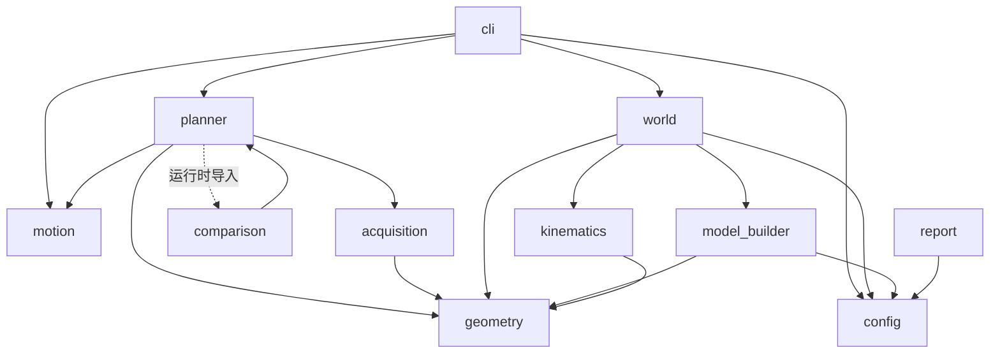
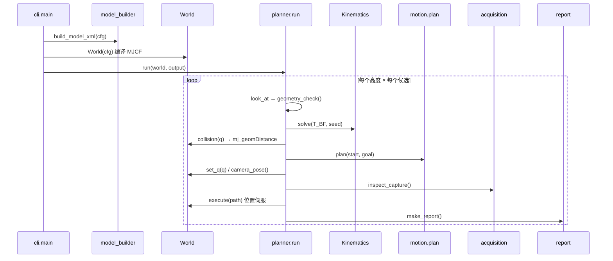

# MuJoCo 仿真场景：代码结构与建模说明

梳理本工程的**代码框架**与**场景建模方式**，回答三个问题：

1. 代码怎么组织、模块如何相互调用；
2. 场景（机器人 / 相机夹具 / 烤箱 / 层架 / 托盘 / 食材）是怎么被**生成**出来的；
3. MuJoCo 的每条曲线（渲染、碰撞、深度、伺服）分别由什么机制实现，边界在哪。

- 工程：`mujoco_viewpoint_sim/`，`viewpoint_sim/` 包共 1246 行
- 引擎：**MuJoCo 3.3.7**（无 PyBullet 依赖）
- 测试：`tests/test_mujoco_workcell.py`，13 项
- 参数逐项含义见 `docs/` 下的配置说明；迁移来龙去脉见 `mujoco_migration_plan.md`

---

## 1. 设计原则

| 原则 | 落地方式 |
|---|---|
| **配置是唯一输入** | MJCF **不落盘**，每次都从 `configs/*.json` 生成，避免手改 XML 与配置脱节 |
| **视觉体与碰撞体分离** | 每个连杆有 `vis_*`（可视网格）和 `col_*`（凸包碰撞网格）两个 geom，渲染与碰撞各自最优 |
| **相机位姿与机器人解耦** | `T_BC` 写进 **mocap body**，不需要改模型、不需要重建 |
| **光心用 site，不用相机系** | `camera_pose()` 读 `site_xpos/site_xmat`，与 `T_BF·T_FC` 严格一致（1e-9 验证） |
| **算法层不依赖引擎** | FK / IK / RRT / 几何判据全在自有代码里，`world.py` 只做引擎适配 |
| **失败可归因** | 每个门禁返回具体原因串，写入 `candidates.jsonl` |
| **结果目录自包含** | `run` 落盘当时的 `config.json`，`replay` 只读快照 |

---

## 2. 代码结构

### 2.1 模块清单

| 模块 | 行数 | 职责 | 关键符号 |
|---|---:|---|---|
| `geometry.py` | 133 | 变换、投影、多边形、裁剪 | `transform` `inv` `apply` `box_vertices` `look_at` `project` `image_contains` `clip_polygon` `tray_ratio` `crop_box` `cropped_intrinsics` |
| `kinematics.py` | 86 | URDF 解析、FK、解析雅可比、有界多初值 IK | `Kinematics` `.fk()` `.solve()` |
| `config.py` | 47 | 装载 + 校验、安装外参 | `ROOT` `load_config` `validate_config` `mount_transform` `clone` |
| **`model_builder.py`** | **145** | **URDF + 配置 → MJCF 字符串** | `build_model_xml` `numbers` `quat` `origin` |
| **`world.py`** | **205** | **MuJoCo 封装：渲染、碰撞、伺服** | `World` `._camera` `.render` `.collision` `.execute` `.isolated_food_masks` `.export_scene` |
| `motion.py` | 78 | 关节插值、边/路径检查、RRT-Connect | `interpolate` `edge_free` `path_free` `plan` |
| `acquisition.py` | 80 | 采集、质量验收、落盘 | `inspect_capture` `save_capture` |
| `planner.py` | 185 | 主流程：采样 → 门禁 → 执行 → 落盘 | `geometry_check` `execute_path` `run` |
| `comparison.py` | 31 | 同 XY 的平移 vs 重 Look-at 对照 | `compare_heights` |
| `report.py` | 35 | 生成零依赖离线 HTML | `make_report` |
| `cli.py` | 86 | 子命令 `run` / `replay` / `check` / `export-model` / `view` | `main` `replay` |

`__init__.py` 里有一行关键的环境准备：Linux 无 `DISPLAY` 时自动 `MUJOCO_GL=egl`，这是无桌面环境能跑渲染的前提。

### 2.2 依赖方向



要点：

- **MuJoCo 只在两处被 import**：`model_builder.py`（生成 XML 时不需要）实际只用到 `xml.etree`，真正的 `import mujoco` 只出现在 `world.py` 和 `cli.py` 的 `view` 分支；
- `config.py` 的 `ROOT` 做了兜底：打包安装后若 `assets/` 不在上一级，则退回当前目录；
- `planner` ↔ `comparison` 双向引用，用函数内延迟导入打破循环。

### 2.3 `run` 的调用链



---

## 3. `World` 的运行时对象模型

`World.__init__` 只有一条主线：**配置 → MJCF 字符串 → 编译成 `MjModel`**。

```python
self.xml   = build_model_xml(cfg)                 # 纯字符串生成，不落盘
self.model = mujoco.MjModel.from_xml_string(self.xml)
self.data  = mujoco.MjData(self.model)
```

随后建立的索引：

| 字段 | 含义 |
|---|---|
| `joint_ids` | 6 个受控关节的 `mjModel.jnt_*` 索引（顺序取自 `kin.names`） |
| `qadr` / `dadr` | 对应的 `qpos` / `qvel` 地址 |
| `flange` | 法兰 body id（`cfg.robot.flange_link`，当前 `link6`） |
| `optical_site` | `site "camera_optical"` 的 id |
| `camera_id` | `camera "render_camera"` 的 id |
| `mocap_id` | mocap body `render_pose` 的 mocap 槽位 |
| `food_ids` | 每个食材的 body id（顺序 = 配置顺序） |
| `names` | body id → 名字（碰撞报错用） |
| `robot_geoms` | 名字以 `col_` 开头的 geom（碰撞用） |
| `env_geoms` | 名字以 `env_` 或 `food_` 开头的 geom |
| `food_geoms` | `env_geoms` 中属于食材 body 的部分 |
| `pairs` | 预计算的待检查 geom 对（含类型标签） |
| `renderers` | `mujoco.Renderer` 缓存，按 `(w,h)` 键 |

### 3.1 MJCF 里的命名约定

整个场景靠**前缀**区分职责，这是碰撞与渲染能各取所需的关键：

| 前缀 | 组 | contype | 用途 |
|---|---:|---:|---|
| `vis_*` | 1 | 0 | 可视网格，**不参与碰撞** |
| `col_*` | 3 | 1 | 凸包碰撞网格，**不参与渲染**（`option.geomgroup[3:]=0`） |
| `env_*` | 0 | 1 | 工位结构（桌、烤箱、托盘、层架） |
| `food_*` | 2 | 1 | 食材，可被单独隔离渲染 |

---

## 4. 建模：MJCF 生成器（`model_builder.py`）

### 4.1 为什么不用 MuJoCo 的 URDF 导入

MuJoCo 能直接 `from_xml_path("*.urdf")`，但会带来三个不可控项：`fusestatic` 默认合并固定关节、URDF 的 `<gazebo>`/`<transmission>` 语义缺失、以及无法插入相机夹具与工位。

因此这里**手工生成 MJCF**：URDF 只当作"关节树 + 位姿 + 限位"的数据源，其余（碰撞体、执行器、材质、相机）全部自己写。

### 4.2 全局段

```xml
<compiler angle="radian" meshdir=".../assets/mycobot_pro_630" autolimits="true"/>
<option timestep="0.002" integrator="implicitfast" gravity="0 0 -9.81">
  <flag nativeccd="enable"/>
</option>
<size njmax="3000" nconmax="1000"/>
<visual>
  <global offwidth="1000" offheight="700" azimuth="135" elevation="-20"/>
  <quality shadowsize="2048" offsamples="4"/>
  <headlight ambient=".45 .45 .45" diffuse=".5 .5 .5" specular=".1 .1 .1"/>
  <map znear=".002" zfar="20"/>
</visual>
<default>
  <geom friction=".7 .01 .001" solref=".02 1"/>
  <joint damping="4" armature=".02"/>
</default>
```

三处值得说明：

- **`implicitfast` + `damping=4` + `armature=.02`**：位置伺服要稳定，阻尼与转子惯量必须给值，否则 `kp=1000` 会振。
- **`znear=.002 / zfar=20`**：深度渲染的裁剪面。`zfar/znear = 10000`，深度精度够用。
- **`njmax/nconmax`**：`mj_step` 走动力学执行时要预留约束槽位，默认值会在接触多时告警。

### 4.3 机器人：从 URDF 关节树重建

```python
links    = {e.get('name'): e for e in urdf.findall('link')}
by_parent = {j.find('parent').get('link'): j for j in urdf.findall('joint')}

for index, name in enumerate(['base'] + [f'link{i}' for i in range(1,7)]):
    joint = by_parent['base' if index == 1 else f'link{index-1}']
    pos, R = origin(joint)                      # URDF <origin xyz rpy>
    body = base.add_body(name=name, pos=pos, quat=quat(R), gravcomp='1')
    body.add_joint(type='hinge', axis=axis_from_urdf,
                   range=f"{limit.lower} {limit.upper}")
    body.add_inertial(pos='0 0 0', mass=..., diaginertia='.008 .008 .008')
```

四个刻意的决定：

1. **`pos` / `quat` 逐字取自 URDF `<origin>`** —— 不对关节做任何重解释；
2. **`axis` 逐字取自 `<axis>`** —— 轴的符号与 URDF 完全一致，因此 `kinematics.fk()` 与 MuJoCo 的 FK 能对到 1e-9（`test_mujoco_fk_matches_official_urdf`）；
3. **`gravcomp="1"`** —— 每个连杆做完全重力补偿。这样位置伺服只需克服惯性，不承担重力，`kp=1000` 能在 4 s 内收敛到 5e-4 rad；
4. **惯量与质量是示例值**（质量 0.9/1.4/1.2/0.45/0.35/0.15 kg，`diaginertia` 统一 `.008`）—— 官方 URDF 的惯性是 `1e-9` 占位，不能用于动力学。文档与 `summary.json` 的 `simulation_limits` 都写明了这一点。

### 4.4 每个连杆两个 geom

```xml
<geom name="vis_link3" type="mesh" mesh="link3_mesh" group="1"
      contype="0" conaffinity="0" mass="0"/>
<geom name="col_link3" type="mesh" mesh="link3_mesh" group="3"
      rgba=".8 .2 .2 .15" mass="0"/>
```

- `vis_*`：正常颜色、`contype=conaffinity=0` → 参与渲染、**不产生接触**；
- `col_*`：MuJoCo 用网格的**凸包**做碰撞，所以形状比可视化网格"胖"；放进 `group=3` 并在渲染与查看器里关掉该组，避免看到红色凸包。

这样做的好处是：碰撞可以为了保守而"胖"，渲染依然是真实外形；两者互不牵连。

### 4.5 相机夹具

```python
half = np.array(cam['housing_size_m']) / 2
housing = base.add_body('camera_housing',
                        pos=mount[:3,3] - mount[:3,:3] @ [0,0,half[2]],
                        quat=quat(mount[:3,:3]))
bracket = base.add_body('camera_bracket', pos=cam['bracket_center_F_m'])
```

- **外壳位置由光心反推**（沿光轴退半个厚度），外壳尺寸改了就自动跟随；
- 支架用 `bracket_center_F_m` 显式给（贴着法兰面）；
- 两者都挂在 `link6` 上，并加入 `<contact><exclude>` 的三对：`link6↔housing`、`link6↔bracket`、`housing↔bracket`。

### 4.6 光心 site 与渲染相机

```xml
<site   name="camera_optical" pos=mount_t quat=mount_R size=".003" rgba="0 0 0 0"/>
<camera name="wrist_camera"   pos=mount_t quat=quat(mount_R @ diag(1,-1,-1))
        sensorsize="640 360" resolution="640 360" focal="337.2 324.7"
        principal="0 0" ipd="0"/>
```

**这是整个工程最关键的一处设计**：光心用 **site** 表达，因为 site 与 body 一样是纯刚体变换，`camera_pose()` 直接读 `site_xpos/site_xmat` 就得到 `T_BF · T_FC`，与 `kinematics.fk(q) @ mount` 严格相等（测试按 1e-9 校验）。

而 `<camera>` 只服务于渲染，坐标系约定不同（`−Z` 朝前、`+Y` 朝上），所以单独乘 `diag(1,-1,-1)`。两者分开，就不会出现"为了渲染改了相机、结果位姿也变了"的问题。

### 4.7 mocap 渲染位姿

```xml
<worldbody>
  <body name="render_pose" mocap="true" pos="0 0 1">
    <camera name="render_camera" .../>
  </body>
</worldbody>
```

任意 `T_BC` 都通过 `data.mocap_pos / mocap_quat` 写入，**不需要改模型**。这替代了 PyBullet 版"把 `T_BC` 直接传进 `computeViewMatrix`"的做法，代价是每次渲染前要跑一次 `mj_kinematics` + `mj_camlight`（两个都很便宜）。

### 4.8 执行器

```xml
<actuator>
  <position name="servo_joint1" joint="joint1" kp="1000" kv="65"
            ctrlrange="lower upper"/>
  ...
</actuator>
```

`ctrlrange` 直接取 URDF 限位，所以 `data.ctrl` 超出限位会被自动钳制。`kp`/`kv` 是示例参数，`summary.json` 里已声明未标定。

### 4.9 接触排除

```python
allowed = SRDF 的 disable_collisions（过滤掉 URDF 里不存在的 link）
allowed |= {('link6','camera_housing'), ('link6','camera_bracket'),
            ('camera_housing','camera_bracket')}
for a, b in sorted(allowed):
    contact.add_exclude(body1=a, body2=b)
```

这就是 PyBullet 版那份手写"允许矩阵"的等价物，但有两个改进：

- **MuJoCo 自带父子过滤**（`filterparent`），相邻连杆不必手工写；
- 排除表同时被 `world.py` 读回来构建 `pairs`，**仿真与距离查询用的是同一份排除关系**，不会两条路径不一致。

---

## 5. 建模：工位

| 配置键 | 生成的 body | 形状 |
|---|---|---|
| `scene.table` | `table` | 1 个 box，贴棋盘格材质 |
| `scene.oven` | `oven_floor` / `oven_back` / `oven_left` / `oven_right` | 4 个 box，**顶部敞开** |
| 同上 | `oven_rack` | 13 根横杆 + 2 根纵梁 + 3 层 × 2 侧导轨，全部 capsule |
| `scene.tray` | `tray` + `tray_left/right/front/back` | 1 个 box + 4 个薄边（`lip_height_m` 为 0 时省略） |
| `scene.obstacles[]` | 每个一项 | box |
| `scene.foods[]` | 每个一项 | box 或 sphere |

### 5.1 烤箱：四面围合、顶面留空

```python
x0, x1 = oven['x_B_m'];  y0, y1 = oven['y_B_m'];  z0, z1 = oven['z_B_m']
t = oven['wall_thickness_m']

box('oven_floor', [c(x0,x1), c(y0,y1), z0 - t/2], [x1-x0+2t, y1-y0+2t, t])
box('oven_back',  [x1 + t/2,   c(y0,y1), c(z0,z1)], [t, y1-y0+2t, z1-z0])
box('oven_left',  [c(x0,x1), y0 - t/2, c(z0,z1)],   [x1-x0, t, z1-z0])
box('oven_right', [c(x0,x1), y1 + t/2, c(z0,z1)],   [x1-x0, t, z1-z0])
```

- **顶面不建**：加了盖子，三个采样高度（300/360/420 mm）就都在腔体外面，取景全废；
- **底板/背板外扩 `t`**，把侧壁的厚度也覆盖进去，四个角是"塞满"的而非对齐的，不会留缝；
- 当前数值：`x=[0.18,0.58]`、`y=[−0.25,0.25]`、`z=[0.005,0.65]`、`t=0.014`。

### 5.2 层架：由腔体与托盘共同确定

```python
z = oven['rack_z_B_m'];  r = oven['rack_rod_radius_m']
for y in np.linspace(y0+.02, y1-.02, 13):      # 13 根横向 rods
    rod([x0+.015, y, z], [x1-.015, y, z])
for x in [x0+.015, x1-.015]:                   # 2 根纵向
    rod([x, y0+.02, z], [x, y1-.02, z])
for k, height in enumerate(oven['rail_heights_B_m']):   # 3 层导轨
    for y in [y0+.008, y1-.008]:
        rod([x0+.01, y, height], [x1-.01, y, height])
```

- 用 **capsule** 而不是 box：圆柱杆在凸包下≈自身，不会像细长 box 那样把间隙"填实"；
- 所有杆件向内侧缩 15–20 mm，避免与墙体共面导致的自接触抖动；
- `rail_heights_B_m` 的 3 个高度同时充当**可视参考层**（查看器里能看到三层横杆），实际承载仍由 `rack_z_B_m` 那一层。

### 5.3 托盘与围边

托盘是一个 box，加上四条 3 mm 厚的边（`lip_height_m`）。边的存在使托盘在物理上是"有帮"的容器，但**边顶面低于 Food ROI 底面**，所以不会遮挡食材——这一点在配置里由 `roi.food_min_B[2] > tray_z + lip_height` 保证。

### 5.4 食材

| 形状 | 生成 |
|---|---|
| `box` | `<geom type="box" size=半尺寸 rgba=.../>`，group=2 |
| `sphere` | `<geom type="sphere" size=半径/>`，group=2 |

约束由 `validate_config` 强制：每个食材的**半尺寸包围盒必须完整落在 ROI 内**，否则启动即报错。

---

## 6. 渲染

### 6.1 相机外参的两次转换

```python
def _camera(self, T_BC, camera):
    # 光学系 +Z 前 / +Y 下  →  MuJoCo +Z 后 / +Y 上
    R = T_BC[:3,:3] @ np.diag([1,-1,-1])
    self.data.mocap_pos[self.mocap_id]  = T_BC[:3,3]
    self.data.mocap_quat[self.mocap_id] = quat_xyzw[[3,0,1,2]]   # w 在前
    mujoco.mj_kinematics(self.model, self.data)
    mujoco.mj_camlight(self.model, self.data)
```

- **绕光学 X 轴转 180°**（`diag(1,-1,-1)`）：这一步漏了，图像会上下颠倒；
- **四元数顺序**：`scipy` 是 `xyzw`，MuJoCo 是 `wxyz`；
- 写完 mocap 必须 `mj_kinematics` + `mj_camlight`，否则 `cam_xpos` 还是旧值。

### 6.2 内参的映射

```python
self.model.cam_sensorsize  [camera_id] = [w, h]
self.model.cam_resolution  [camera_id] = [w, h]
self.model.cam_intrinsic   [camera_id] = [fx, fy,
                                          w/2 - (cx + 0.5),
                                          cy + 0.5 - h/2]
```

三个细节都是**实测标定出来的**，不是推导的：

| 项 | 我们的约定 | MuJoCo 约定 | 转换 |
|---|---|---|---|
| 主点 X | 左上角原点 `cx` | 图像中心偏移 | `w/2 - (cx+0.5)` |
| 主点 Y | 左上角原点 `cy` | 图像中心偏移、向上为正 | `cy+0.5 - h/2` |
| 半像素 | OpenCV 像素中心 | 光栅中心 | 各自的 `+0.5` 抵消 |

`test_off_center_camera_intrinsics` 用偏心主点（`cx=280, cy=155`）把投影框与分割图实际边界对比，容差 **1.2 px**——这是这套映射唯一的验证依据，改任何一项都要重跑它。

### 6.3 三种图像一次渲染

```python
option = mujoco.MjvOption(); mujoco.mjv_defaultOption(option)
option.geomgroup[3:] = 0        # 隐藏 col_* 碰撞网格

renderer.update_scene(data, camera='render_camera', scene_option=option)
rgb   = renderer.render().copy()                                    # RGB
renderer.enable_depth_rendering();  depth = renderer.render().copy() # 深度
renderer.enable_segmentation_rendering(); seg = renderer.render()    # 分割
```

- **`geomgroup[3:] = 0`** 是关键：碰撞凸包不参与渲染，否则相机画面里会出现半透明红色网格；
- **分割 → body id**：
  ```python
  ids   = seg[:,:,0]
  valid = (seg[:,:,1] == mjtObj.mjOBJ_GEOM) & (ids >= 0)
  body[valid] = model.geom_bodyid[ids[valid]]
  ```
  `seg` 的第二通道是对象类型，必须先过滤，否则会把 light/camera 的 id 误当 geom。

### 6.4 深度语义

`mujoco.Renderer` 的深度是**米**，且是**沿光轴的 Z**（相机平面距离），与 `geometry.project()` 定义一致。

验证方式：正对托盘、距 360 mm 处渲染，断言 `z[180,320] ≈ 0.36`（`test_rgb_depth_and_segmentation_are_aligned`，`places=4`）。

这比 PyBullet 省事——那边返回的是非线性深度缓冲，还得按 `far*near/(far-(far-near)*buf)` 反算。

### 6.5 隔离轮廓（可见率的分母）

```python
def isolated_food_masks(self, T_BC):
    groups = self.model.geom_group.copy()
    try:
        for body in self.food_ids:
            self.model.geom_group[self.food_geoms] = 5      # 全部食材隐藏
            own = [g for g in self.food_geoms if geom_bodyid[g] == body]
            self.model.geom_group[own] = 2                  # 只显示当前这块
            _, _, ids = self.render(T_BC, segmentation_only=True, food_only=True)
            masks.append(ids == body)
    finally:
        self.model.geom_group[:] = groups
```

利用 **geom group 的可切换性**：把其他食材降到不可见组，只留自己，渲染一张纯轮廓。

- 分母含**自身遮挡**，排除**他人遮挡** → "被别的食材挡住"会真实计入可见率损失；
- 全程 `try/finally` 恢复 `geom_group`，异常也不会留下脏状态；
- `food_only` 模式把 `geomgroup` 全部清零只开 group 2，因此这张图里不会有桌子和手臂。

### 6.6 第三人称预览

`overview()` 用一条独立虚拟相机：

```python
look_at([-0.80, -0.70, 0.65], [0.28, 0, 0.28], [0, 0, 1])
fx = fy = 800, 960×640
```

只用于 `overview.png` 与 GIF，**不参与任何判定**。

---

## 7. 碰撞模型

### 7.1 三阶段过滤

```python
def collision_current(self):
    # ① 关节限位（软裕量）
    if np.any(q < lower + m) or np.any(q > upper - m): return 'joint_limit'

    margin = cfg['motion']['collision_margin_m']    # 2 mm
    # ② 球包围盒粗筛，向量化一次算完
    broad = norm(geom_xpos[a] - geom_xpos[b]) - geom_rbound[a] - geom_rbound[b]
    for index in np.flatnonzero(broad < margin):
        # ③ 精确有符号距离
        g1, g2, kind = self.pairs[index]
        distance = mujoco.mj_geomDistance(model, data, g1, g2, margin, None)
        if distance < margin - 1e-10:
            return f'{kind}:{geom_name(g1)}:{geom_name(g2)}'
    return None
```

| 阶段 | 机制 | 作用 |
|---|---|---|
| ① | `kin.lower/upper` + `joint_limit_margin_rad` | 裕量收缩，避免贴死限位 |
| ② | `geom_rbound`（球包围半径）+ `geom_xpos` | 一次 NumPy 运算淘汰绝大多数对，无逐对 API 调用 |
| ③ | `mj_geomDistance(model, data, g1, g2, distmax=margin)` | 返回**有符号**距离；`distmax` 内无接触时返回 `distmax` |

**为什么不用 `<geom margin>` + `data.contact`**：`margin` 是两个 geom 的"膨胀"，两个都设就会叠加，接触判定会悄悄变严 2 倍；而 `mj_geomDistance` 是**显式逐对查询**，语义只有"几何距离小于 2 mm 算碰撞"，没有隐藏的合成规则。代价是每对一次调用，所以先用 ② 粗筛。

### 7.2 待检查对的构造

```python
for k, a in enumerate(robot_geoms):
    for b in robot_geoms[k+1:]:                       # 自碰撞
        if geom_bodyid[a] != geom_bodyid[b] and (ba,bb) not in allowed:
            pairs.append((a, b, 'self_collision'))
    for b in env_geoms:                               # 环境碰撞
        if body(a) == 'base' and body(b) == 'table': continue   # 底座装在工作台上
        pairs.append((a, b, 'environment_collision'))
```

三个过滤条件：

1. **同一 body 内不自检**：凸包网格同体的两个 geom 天然"相交"，查了必然误报；
2. **`allowed` 来自同一份 `<contact><exclude>`**：仿真与查询用同一套排除关系；
3. **`base` ↔ `table` 豁免**：机器人底座固定在工作台上，这是装配接触。

**与 PyBullet 版的差别**：那边需要手写"法兰平面内 12 mm 圆盘"的局部豁免（因为腕部网格与支架必然接触）。这里把 `link6↔housing`、`link6↔bracket`、`housing↔bracket` 三对整体排除，因为夹具是刚性装配、不存在相对运动，整对豁免是安全的。

### 7.3 已知局限

| 局限 | 影响 |
|---|---|
| **凸包近似** | `col_*` 用网格凸包。细长凹形（如腕部凹陷、层架间隙）在碰撞上被填实，偏保守 |
| **离散检测** | `edge_free` 按关节角步长插值，没有连续碰撞检测（CCD），见 §8.2 |
| **球包围盒粗筛** | `geom_rbound` 是外接球，对细长连杆偏大 → 粗筛只影响性能，不影响正确性 |
| **球 vs 凸包** | 食材是 box/sphere，用 MuJoCo 原生解析碰撞，精确 |

---

## 8. 运动模型

### 8.1 两种执行方式

`cfg.motion.execution_mode` 决定走哪条：

| 值 | 做法 | 用途 |
|---|---|---|
| `kinematic` | 逐插值点 `set_q`，每点查碰撞，GUI 下 `sync + sleep(.015)` | 快速回放、调试 |
| `position_control`（默认） | `mj_step` + `ctrl=目标` + 三次缓动，收敛判据验收 | 接近真机的执行语义 |

`position_control` 的单段逻辑：

```python
delta    = max|b - a|
duration = max(1.5*delta/v_max, sqrt(6*delta/a_max), dt)
for u in linspace(0, 1, ceil(duration/dt)+1):
    data.ctrl = a + (b-a)*(3u² - 2u³)      # S 曲线，速度与加速度都连续
    mj_step(model, data)
    mj_forward(model, data)                 # ← 必须补一次
    check collision_current()
```

**`mj_forward` 那行不是冗余**：`mj_step` 先算力、再积分 `qpos`，最后才更新 `xpos`。若直接读 `data.xpos` 做碰撞检查，拿到的是**上一帧**的位姿。代码注释里写明了这一点。

结束后进入"稳定判定"：

```python
stable = 0; required = settle_hold_s / dt
while 未超时:
    step(goal)
    if max|q - goal| < 5e-4  and  max|qvel| < 0.003:
        stable += 1
    else:
        stable = 0
    if stable >= required: return stats     # 连续 0.1 s 满足才认为稳定
raise RuntimeError('Position servo did not reach the configured settling criterion')
```

判定用**"连续保持"**而不是"首次进入"，这样可以排除过冲、抖动后恰好穿过窗口的情形。返回值带 `physics_steps`、`max_joint_speed_rad_s`、`arrived_joint_error_rad`、`arrived_joint_velocity_rad_s`，全部落进 `views.json`——这就是"到位稳定"的量化证据（对应规格 §10.2 那条此前缺失的判据）。

### 8.2 规划器（与引擎无关）

`motion.plan` 是标准 RRT-Connect：直连优先 → 双向树 → 随机短路（每条捷径先整边验过）→ 返回前 `path_free` 复核。

需要强调的边界：**`edge_free` 是离散检查，不是 CCD**。理论上要满足 `步长 × 连杆包络半径 < 最小障碍厚度/2` 才不漏检。本工程的保守做法是 `edge_resolution_rad = 0.025`，并在 `replay` 时再独立复核一遍。

---

## 9. 传感与质量验收

`acquisition.inspect_capture()` 一次渲染产出四样东西：RGB、光学 Z、实例标签、质量指标。

| 指标 | 定义 | 阈值键 |
|---|---|---|
| `visible_fraction` | 实占像素 / 隔离轮廓像素 | `min_visible_fraction_per_food`（`visibility_mode` 决定是否拦） |
| `valid_depth_fraction` | 食材像素中落在 `depth_range_m` 内的比例 | `min_valid_depth_fraction` |
| `visible_pixels` / `min_bbox_side_px` | 像素数与最小包围盒边 | `min_food_pixels`、`min_food_bbox_side_px` |
| `cut` | 是否触到图像四边 | — |

失败原因按优先级排序：`occlusion` < `food_cut_by_image_border` < `invalid_depth` < `insufficient_food_pixels`，保证归因稳定（不受 `set` 迭代顺序影响）。

落盘约定：

- `depth_mm.png`（uint16，0 表示无效）+ `depth_z_m.npy`（float32 原始米值，未做量程掩膜）；
- `instance.png`（0=背景，1..N 按配置顺序）；
- `metadata.json` 里写明 `label_definition` 与 `depth_definition`，避免下游误读；
- 裁剪是可选派生分支（`postprocess.crop_mode = tray_roi`），`crop_*` 前缀另存，并在保存前断言"裁剪不会切掉任何可见食材像素"。

---

## 10. 单次候选的生命周期

`planner.run()` 每个候选走 9 个阶段：

| # | 阶段 | 实现 | 可能原因 |
|---:|---|---|---|
| 1 | SAMPLE | `sample_rng` 抽 XY + `z_jitter_m` | — |
| 2 | GEOMETRY | `geometry_check(target)` | `food_out_of_rgb_fov`、`depth_range`、`tilt`、`tray_ratio`… |
| 3 | 去重（提前） | 与已接受光轴比夹角 | `duplicate_axis` |
| 4 | IK | `kin.solve(T_BF, seed)` | `ik_or_singularity` |
| 5 | COLLISION | `world.collision(q)` | `self_collision`、`environment_collision`、`joint_limit` |
| 6 | PATH | `motion.plan()` | `path_not_found` |
| 7 | 实际位姿复核 | `set_q` → `camera_pose()` → `geometry_check(actual)` | `actual_*` |
| 8 | CAPTURE/QUALITY | `inspect_capture()` | `occlusion`、`invalid_depth`… |
| 9 | EXECUTE/SAVE | `world.execute(path)` + `save_capture` | 执行期碰撞抛 `RuntimeError` |

第 3 步放在 IK **之前**：去重是一次点积，IK+碰撞+RRT 是毫秒到秒级。

第 9 步之后还有一次**到位复核**：`execute` 结束后重新 `geometry_check` 与 `inspect_capture`，若不合格则把该候选记为 `moved=True` 的失败并推进 `current`。因为位置伺服到达的实际位姿与 IK 目标之间有微小差（`pe`、`re` 落盘），几何指标必须按**实际位姿**重算，不能复用预览值。

---

## 11. 确定性与可复现

```python
seeds = np.random.SeedSequence(cfg["seed"]).spawn(4)
sample_rng, ik_rng, path_rng, jitter_rng = [default_rng(s) for s in seeds]
```

| 流 | 消费者 | 隔离目的 |
|---|---|---|
| `sample_rng` | XY 采样 | 改 IK/RRT 参数不影响采样序列 |
| `ik_rng` | 多初值起点 | 同上 |
| `path_rng` | RRT 采样、短路选点 | 同上 |
| `jitter_rng` | `z_jitter_m` | Δ=0 时不抽数，历史种子逐位复现 |

**执行阶段不是逐位确定的**：`position_control` 走 `mj_step`，虽然给定初值与 `ctrl` 序列结果确定，但 `settle` 循环的步数取决于浮点收敛，`physics_steps` 可能与上次差一两步。因此可复现的边界是：

- **采样、IK、路径、几何判据 → 逐位可复现**（纯 NumPy/SciPy）；
- **到位位姿、图像指标 → 可复现但需允许极小量差**（接触求解与浮点积分）；
- **像素 → 依赖 GPU/驱动**，同一台机器稳定，换机器可能差几个灰阶。

---

## 12. 测试与文档对应

| 测试类 | 项数 | 覆盖 |
|---|---:|---|
| `GeometryAndConfigTests` | 4 | 默认配置与非法配置、Look-at 与安装外参闭合、网格单位换算（7 个网格 ±1 mm）、过低/过高高度的拒绝 |
| `MuJoCoWorldTests` | 8 | **MuJoCo FK 与自有 FK 一致（1e-9）**、RGB/深度/分割对齐、偏心主点投影（1.2 px）、隔离轮廓、裁剪可选项逐像素一致、**位置伺服收敛**、加障碍物改变可行性、烤箱顶面敞开 |
| `PathTests` | 1 | 端点安全不等于边安全（中段障碍） |
| **合计** | **13** | — |

两条最有价值的断言：

- `test_mujoco_fk_matches_official_urdf`：把"MJCF 生成是否忠于 URDF"变成硬约束。这条一旦红了，说明关节 origin/axis 在生成链路里被改动了。
- `test_position_servos_settle_using_physics_steps`：执行真走 `mj_step`，且收敛到 `5e-4 rad / 0.003 rad/s`。它同时证明"`ctrl` 接线正确"和"阻尼/增益没有配坏"。

---

## 13. 与 PyBullet 版的差异

| 维度 | PyBullet 版 | MuJoCo 版 |
|---|---|---|
| 场景来源 | 运行时 `createMultiBody` 逐个拼 | **每次从配置生成 MJCF**，可 `export-model` 落盘单独查看 |
| 机器人 | `loadURDF` | 手工生成 MJCF（不动 URDF 语义） |
| 相机位姿 | 传进 `computeViewMatrix` | mocap body + `mj_kinematics` |
| 光心 | 法兰位姿 × 安装外参 | **site**（更直接，1e-9 对齐 FK） |
| 碰撞 | `getClosestPoints(robot, body, 2mm)` | **球粗筛 + `mj_geomDistance` 逐对** |
| 深度 | 非线性缓冲需反算 | 直接是米 |
| 执行 | `resetJointState`（纯运动学） | **位置伺服 `mj_step`** + 稳定判据 |
| 夹具豁免 | 法兰平面 12 mm 圆盘的局部豁免 | 三对 body 整体 exclude（刚性装配） |
| 可视化辅助物 | `addUserDebugLine/Text` | 交给查看器（`user_scn` 未启用），字面信息只打印到终端 |

最后一行是唯一的**功能退步**：视图里不再画 ROI 线框、托盘边框和高度文字。它们不影响任何判定，但如果需要，可以后续用 `viewer.user_scn` + `mjv_initGeom` 补回来（文字需另找方案）。

---

## 14. 已知局限与技术债

| 项 | 位置 | 说明 |
|---|---|---|
| 惯量与伺服增益是示例值 | `model_builder.py` | 官方 URDF 惯性为 1e-9 占位；质量/`kp`/`kv` 未标定，`summary.json` 已声明 |
| 无动力学标定 | `model_builder.py` | 摩擦、阻尼、转子惯量都是估计值，不能用于力控验证 |
| 可视化辅助物缺失 | `world.draw_view` | 只 `viewer.sync()`，无 ROI/视锥线框 |
| 离散碰撞 | `motion.edge_free` | 非 CCD，无隧穿量化界 |
| 凸包碰撞 | `col_*` geom | 凹形结构被填实，偏保守 |
| `ROI` 与 `scene` 双重描述 | `configs/*.json` | 无交叉校验（仅校验食材落在 ROI 内） |
| 确定性边界 | `World.execute` | 采样/IK/路径逐位可复现；到位与像素允许极小量差 |
| `model.geom_group` 被运行时改写 | `world.isolated_food_masks` | 有 `try/finally` 恢复，但若进程被杀会残留（仅影响当次进程） |
| `renderer` 缓存不随分辨率释放 | `world.renderers` | 只按 `(w,h)` 缓存，`close()` 统一释放 |

---

## 15. 扩展指引

| 想做什么 | 改哪里 | 注意 |
|---|---|---|
| 加一个障碍物 | `scene.obstacles[]` 追加 `{name, position_B_m, size_m, rgba?}` | 自动进 `env_*` 并参与碰撞 |
| 加一块食材 | `scene.foods[]` 追加，同时扩 `roi.food_min/max_B` | 实例 ID 按顺序递增，改变 `instance.png` 语义 |
| 改烤箱尺寸 | `scene.oven.x_B_m / y_B_m / z_B_m` | 顶面恒敞开；改 `z_B_m[1]` 会影响导轨高度是否合理 |
| 改托盘 | `scene.tray` + `roi.tray_z_B_m` + `roi.tray_corners_B` | 三处必须同步 |
| 改层架 | `scene.oven.rack_z_B_m`、`rack_rod_radius_m`、`rail_heights_B_m` | 杆半径过大时会与墙体干涉 |
| 换机器人 | `robot.*` + `assets/` 新目录 + `model_builder` 的 `['base']+link1..6` 列表 | 关节数不是 6 时该循环要改 |
| 换相机支架 | `camera.mount` + `housing_size_m` + `bracket_size_m` + `bracket_center_F_m` | 外壳位置自动跟随光心；三对 exclude 的 body 名要同步 |
| 改用动力学执行 | `motion.execution_mode = "position_control"`（已是默认） | 先标定惯量/增益，否则 `settle` 会超时 |
| 加 GUI 可视化线框 | `World.draw_view` / `viewer.user_scn` | 参考 `mjv_initGeom`；本次未实现 |
| 想单独看场景 | `python -m viewpoint_sim export-model` 后 `python -m mujoco.viewer --mjcf=...` | 导出的 MJCF 用相对 meshdir |
