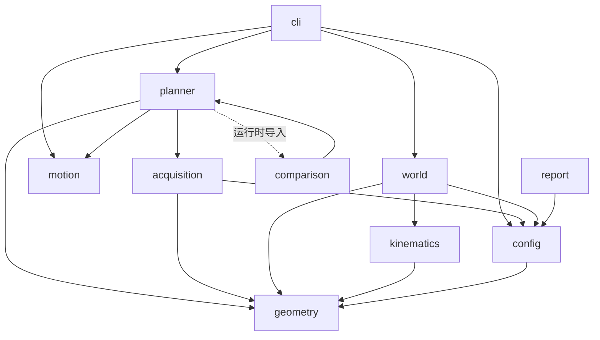
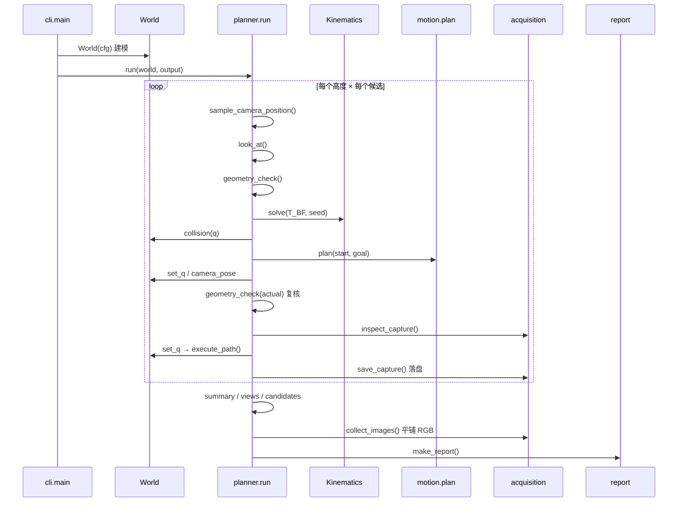

# PyBullet 仿真场景：代码结构与建模说明

本文档梳理当前仿真工程的**代码框架**与**场景建模方式**，回答两个问题：

1. 代码怎么组织、模块如何相互调用；
2. 场景里的机器人、相机夹具、烤箱、层架、托盘、食材是怎么被"建"出来的，约束由谁保证。

- 对应提交：`38ff282`（myCobot 630 Pro + 开口烤箱工位）
- 相关文档：参数逐项说明见 `config_reference.md`，验证结果见 `validation.md`，ROS 2 迁移计划见 `ros2_migration_plan.md`

---

## 1. 设计原则

| 原则 | 落地方式 |
|---|---|
| **物理约束优先于坐标** | 前侧挡板宽度取自腔体外宽、层架顶面取自托盘底面——由构造保证，而不是靠人填对数字 |
| **几何判据与渲染分离** | `roi` 决定算法判据、`scene` 决定渲染与碰撞；两者是独立描述（见 §5.5） |
| **纯函数优先** | 只有 `world.py` 持有仿真状态，其余模块是"输入 → 输出"的纯计算 |
| **可复现** | 三路独立随机流（采样 / IK / 路径），同一 `seed` 逐位复现 |
| **失败要可归因** | 每个门禁返回具体原因字符串（`food_out_of_rgb_fov`、`self_collision:6:9`…），写入 `candidates.jsonl` |
| **结果目录自包含** | `run` 把当时的 `config.json` 落盘，`replay` / `verify_results.py` 只读快照，不受后续改配置影响 |

---

## 2. 代码结构

### 2.1 模块清单

| 模块 | 行数 | 职责 | 关键符号 |
|---|---:|---|---|
| `geometry.py` | 133 | 变换、投影、多边形、裁剪、内参 | `transform` `inv` `apply` `look_at` `project` `image_contains` `clip_polygon` `tray_ratio` `crop_box` `projection_matrix` `cropped_intrinsics` |
| `kinematics.py` | 90 | URDF 解析、FK、解析雅可比、有界多初值 IK | `Kinematics` `.fk()` `.solve()` |
| `config.py` | 137 | 加载 / 校验配置、相机安装外参、裁剪开关 | `load_config` `validate_config` `mount_transform` `crop_settings` |
| `motion.py` | 78 | 关节插值、边/路径碰撞检查、RRT-Connect | `interpolate` `edge_free` `path_free` `plan` |
| **`world.py`** | **359** | **PyBullet 场景：建模、碰撞、渲染** | `World` `._oven_boxes` `._rack_boxes` `.collision` `.render` `.isolated_food_masks` |
| `acquisition.py` | 155 | 采集、质量验收、导出、平铺 RGB | `inspect_capture` `save_capture` `collect_images` |
| `planner.py` | 207 | 主流程：采样 → 门禁 → 执行 → 落盘 | `geometry_check` `sample_camera_position` `execute_path` `run` |
| `comparison.py` | 31 | 同 XY 的平移 vs 重 Look-at 对照 | `compare_heights` |
| `report.py` | 46 | 生成零依赖离线 HTML 报告 | `make_report` |
| `cli.py` | 145 | 子命令 `run` / `replay` / `check` | `main` `replay` |

合计约 1386 行（`viewpoint_sim/` 包内）。

### 2.2 依赖方向



要点：

- **`geometry` 是唯一的叶子依赖**，只依赖 numpy / scipy，无状态、易测；
- **`world` 是唯一持有 PyBullet 状态的模块**（`cli.replay()` 另有一处函数内局部导入，用于搭建只做路径复核的影子客户端）；
- `planner` 与 `comparison` 存在**双向引用**，用"函数内延迟导入"打破循环：

  ```python
  # planner.run() 末尾
  from .comparison import compare_heights
  ```

- `motion` 只依赖 numpy，通过参数拿到 `world` 对象（鸭子类型），不 import `world`。

### 2.3 `run` 的调用链



---

## 3. `World` 的运行时对象模型

`World.__init__` 完成后，一个 PyBullet 客户端里恰好有 **8 个多体（multibody）**：

| Body ID | 名称 | 视觉形状数 | 归属列表 |
|---:|---|---:|---|
| 0 | `robot` | 9 | `self.robot` |
| 1 | `table` | 1 | `environment` |
| 2 | `tray` | 1 | `environment` |
| 3 | `oven` | 4 | `environment` |
| 4 | `rack` | 8 | `environment` |
| 5 | `food_A` | 1 | `food_ids` |
| 6 | `food_B` | 1 | `food_ids` |
| 7 | `food_C` | 1 | `food_ids` |

（`robot` 的 9 个视觉形状 = 7 个原有 link + 运行时注入的 `camera_bracket` + `camera_housing`。）

内部状态与用途：

| 字段 | 类型 | 用途 |
|---|---|---|
| `cid` | int | `PhysicsClientId`，所有 PyBullet 调用都显式传它 |
| `tmp` | `TemporaryDirectory` | 存放运行时生成的 `robot_camera.urdf` |
| `kin` | `Kinematics` | 自写 FK/IK，与 PyBullet 的 link frame 独立 |
| `link_ids` | dict[str,int] | link 名 → PyBullet 索引；`dummy_link` 与根 link 映射到 `-1` |
| `joints` | list[int] | 6 个可动关节的 PyBullet 关节索引 |
| `flange` | int | 法兰 link 索引（当前模型为 `flange`，值为 7） |
| `allowed` | set[frozenset] | 自碰撞豁免矩阵（当前 14 对） |
| `environment` | list[int] | 静态环境 body（table/tray/oven/rack/obstacles） |
| `food_ids` | list[int] | 食材 body，顺序即实例 ID 1..N |
| `names` | dict[int,str] | body id → 名字，用于碰撞报错 |
| `visuals` | list[(body,link,rgba)] | 渲染可见性开关前保存的原始颜色，供 `isolated_food_masks` 恢复 |
| `mount` | 4×4 | `T_FC`，相机相对法兰 |

---

## 4. 建模：机器人

### 4.1 两条并行的运动学路径

| 路径 | 实现 | 用途 |
|---|---|---|
| **自写 FK** | `kinematics.Kinematics.fk()`：解析 URDF，沿 `parent` 链回溯 | IK 残差计算、奇异值判定、`verify_results.py` 独立复核 |
| **PyBullet FK** | `p.getLinkState(..., computeForwardKinematics=True)` | 渲染、碰撞、`camera_pose()` |

两者必须一致，由 `test_fk_matches_bullet_link_frame` 卡住（容差 1e-6）。这是刻意的冗余：如果只有一条路径，URDF 解析错误会被渲染结果"自证正确"。

### 4.2 URDF 解析

`Kinematics.__init__(urdf, flange, base_position)`：

```python
by_child = {joint.child: joint}          # 子 link → 关节
chain = []                               # 从法兰向上回溯到根
while name in by_child: chain.append(by_child[name]); name = parent
self.chain = 遍历 reversed(chain)          # 根 → 法兰
```

- 只把 `type != "fixed"` 的关节计入自由度（当前 6 个：`joint1..joint6`）
- 固定关节（`dummy_joint`、`joint6_flange`）只贡献变换，不占 `q`
- 限位来自 `<limit lower upper>`，`joint_limit_margin_rad` 在**使用时**收缩，不修改 URDF 原值

### 4.3 法兰坐标系

上游 630 Pro URDF 没有独立法兰 link，链终止在 `J6_Link`。工程在 URDF 末尾追加：

```xml
<link name="flange"><inertial>…占位 0.001 kg…</inertial></link>
<joint name="joint6_flange" type="fixed">
  <origin xyz="0 -0.012 0" rpy="1.5707963267948966 0 0" />
  <parent link="J6_Link" /> <child link="flange" />
</joint>
```

依据：`J6_Link` 网格 AABB 在 Y 向只有 15 mm 厚（`-0.010 … +0.005`），机械板法向为 J6 的 −Y；joint6 转轴同为 `(0,−1,0)`。`-0.012` 比板面多 2 mm，避免占位支架的凸包一开始就与板面穿透。

配置里 `robot.flange_link = "flange"`，`base_position_B_m = [0,0,0]`。

### 4.4 模型加载

```python
urdf = self._camera_urdf(source)                  # 先注入相机夹具，见 §5
self.robot = p.loadURDF(urdf, base_position,
                        useFixedBase=True,
                        flags=p.URDF_USE_SELF_COLLISION)
```

- `useFixedBase=True`：底座固定，不做动力学
- `URDF_USE_SELF_COLLISION`：启用自碰撞，配合 `allowed` 矩阵使用
- `p.setGravity(0,0,0)`：全程"零重力"，姿态只由 `resetJointState` 直接写入

---

## 5. 建模：相机夹具（运行时注入）

相机不在 URDF 文件里，而是每次启动时**动态注入**到机器人 URDF 的副本里，写到临时目录再加载。原因：夹具是示例几何，改尺寸要立刻生效，且不应污染官方资产。

### 5.1 注入流程

```python
def _camera_urdf(self, source):
    tree = ET.parse(source)
    for mesh in root.findall(".//mesh"):          # ① 网格相对路径 → 绝对路径
        mesh.set("filename", str((source.parent/mesh.get("filename")).resolve()))
    add_box("camera_housing", center, rpy, size, [.10,.15,.20,1])
    add_box("camera_bracket", [0,0,bs[2]/2], [0,0,0], bs, [.18,.65,.70,1])
    tree.write(tmp/"robot_camera.urdf")           # ② 写临时文件
```

每个 `add_box` 生成三件套：`<link>`（带占位惯性 0.06 kg）+ `<visual>` + `<collision>`，再加一个 `type="fixed"` 的关节挂到法兰上。

### 5.2 几何推导

| 部件 | 位置 | 尺寸 |
|---|---|---|
| `camera_bracket` | 法兰原点沿 +Z 外移半长：`[0, 0, bs_z/2]` | `camera.bracket_size_m` = `[0.012, 0.012, 0.036]` |
| `camera_housing` | **由光心反推**：`mount.t - mount.R @ [0,0,size_z/2]` | `camera.housing_size_m` = `[0.042, 0.042, 0.023]` |
| `camera_housing` 朝向 | `camera.mount.rpy_FC_rad`（与光轴一致） | — |

关键点：**外壳位置不是独立配置项**，而是从 `T_FC` 的光心位置反推出来的。这样光心一动，外壳自动跟随，不会出现"相机在 A 处、外壳在 B 处"。

### 5.3 光学与碰撞的分离

外壳 / 支架**只参与碰撞**，不参与成像。成像用 `camera.rgb` 内参 + `T_BC`，与外壳尺寸无关。因此改外壳尺寸不会影响任何图像指标，只会影响可达性与自碰撞判定。

---

## 6. 建模：工位

### 6.1 配置 → body 映射

`scene` 段有 6 个键，对应 5 类 body：

| 配置键 | body | 形状 | 颜色 |
|---|---|---|---|
| `table` | `table` | 单个 box | `[.24,.29,.35,1]` |
| `tray` | `tray` | 单个 box | `[.28,.32,.36,1]` |
| `oven` | `oven` | 4（或 5）个 box 组合 | `[.55,.60,.65,1]` |
| `rack` | `rack` | 8 个 box 组合 | `[.60,.61,.64,1]` |
| `obstacles[]` | 每个元素一个 body | 单个 box | `[.55,.60,.65,1]` |
| `foods[]` | 每个元素一个 body | box 或 sphere | 各自 `rgba` |

### 6.2 单 box 与组合 box

两种构造原语：

```python
box(name, xyz, size, rgba)          # 1 个 collision + 1 个 visual
boxes(name, parts, rgba)            # N 个 collision + N 个 visual，合成 1 个 body
```

`boxes()` 用 `createCollisionShapeArray` / `createVisualShapeArray`，把所有子形状的偏移写成相对同一个基准点的局部坐标：

```python
base = parts[0][0]
offsets = [centre - base for centre, _ in parts]
```

**为什么要合并**：碰撞查询是 `getClosestPoints(robot, body)`，按 body 计一次。烤架有 12 个（现为 8 个）薄板，若各自成 body，每次候选要多做 11 次查询；合并后仍是 1 次。

### 6.3 烤箱腔体：由物理约束推导

`_oven_boxes(oven)` 返回 4 个（`top=true` 时 5 个）`(centre, size)`：

| 部件 | X 范围 | Y 范围 | Z 范围 |
|---|---|---|---|
| 底板 | `[x0, x1]` | `[y0, y1]` | `[z0−ft, z0]` |
| −Y 侧壁 | `[x0, x1]` | `[y0, y0+t]` | `[z0, z0+h]` |
| +Y 侧壁 | `[x0, x1]` | `[y1−t, y1]` | `[z0, z0+h]` |
| **+X 前侧挡板** | `[x1−t, x1]` | **`[y0, y1]`（全宽）** | `[z0, z0+h]` |
| 顶盖（可选） | `[x0, x1]` | `[y0, y1]` | `[z1, z1+t]` |

三处刻意的设计：

1. **前侧挡板取全外宽 `[y0, y1]`**，侧壁也贯穿整个 X 深度，两者在角部**重叠**。若挡板宽度缩到内宽 `[y0+t, y1−t]`，两个后角各留 `t×t` 的方孔——这正是改造前的缺陷。`test_oven_panels_leave_no_gap_behind_the_tray` 从腔体内部 7×9 个位置向 +X / ±Y / −Z 打射线，任一处漏出即失败（用旧参数跑同一套检查会漏 18 处）。
2. **−X 面不加板**：那是机器人进出与相机取景的门洞。
3. **`top` 默认 `false`**：加盖会挡住 200 mm 基准高度上浮后的取景。

当前数值：`x=[0.24, 0.62]`、`y=[−0.176, 0.176]`、`z0=−0.03`、`t=0.012`、`ft=0.006`、`h=0.19`，即壁顶 Z = 0.16。

### 6.4 层架：挂在侧壁上

`_rack_boxes(scene)` 依据"侧壁承载"的物理关系推导：

```python
inner_y0, inner_y1 = y0+t, y1-t          # 两侧壁内表面
top = tray_bottom                        # 层架顶面 = 托盘底面
level = top - wire                       # 层架底面
```

| 部件 | 数量 | X 范围 | Y 范围 | Z |
|---|---:|---|---|---|
| 纵条 | `longitudinal_rails` = 3 | 托盘 X ± `margin`，夹到腔内 | 最外两根**贴内表面**，中间一根居中 | `[level, top]` |
| 横档 | `cross_slats` = 5 | 等距分布 | **`[inner_y0, inner_y1]` 全内宽** | `[level, top]` |

- 横向两端的 Y 边界**恰好等于侧壁内表面**，所以是接触承载，不是悬空
- 所有构件 Z 跨度只有一个丝径（3 mm），没有竖向支腿 → 层架离腔底 35 mm
- `top = tray_bottom` 使"托盘放在层架上"由构造保证；改托盘厚度时层架自动跟随

对应测试：`test_rack_hangs_on_the_side_walls_instead_of_standing_on_the_floor` 断言构件数 = 纵条 + 横档（无腿）、Y 边界等于内表面、Z 跨度 = 丝径、离腔底 > 20 mm。

### 6.5 食材

| 形状 | 构造 |
|---|---|
| `box` | `box(name, position, size_m, rgba, food=True)` |
| `sphere` | `createCollisionShape(GEOM_SPHERE)` + `createVisualShape(GEOM_SPHERE)` |

其他 `shape` 值直接抛 `ValueError("Only box/sphere food shapes are supported")`。

- `food=True` 使 body 进入 `food_ids` 而非 `environment`；
- **`food_ids` 的顺序 = `instance.png` 里的实例 ID 1..N**，所以配置里调整顺序会改变 Mask 语义；
- 食材必须完整落在未加裕量的 Food ROI 内，由 `validate_config` 强制。

当前三块食材底面都落在 Z = 0.02（托盘上表面）：`food_A` box `0.055×0.032×0.042`、`food_B` sphere `r=0.022`、`food_C` box `0.028×0.028×0.036`。

### 6.6 两种建模风格并存

| 风格 | 用于 | 特点 |
|---|---|---|
| **参数化推导** | `oven`、`rack` | 只需给物理量（腔体范围、壁厚、丝径），部件位置由约束算出；改尺寸不会破坏关系 |
| **自由摆放** | `obstacles[]`、`foods[]` | 直接给 `position` + `size`，灵活但需要人工保证与 ROI 一致 |

`obstacles` 当前是空数组，真实烤箱的门框、线缆可在此补充（每项 `{name, position_B_m, size_m}`）。

---

## 7. 建模：ROI 与场景的双重描述

这是最容易出问题的地方，值得单独说明。

| 描述 | 存储位置 | 谁用 | 用途 |
|---|---|---|---|
| **ROI** | `roi.food_min_B/max_B`、`roi.tray_corners_B`、`roi.tray_z_B_m` | `geometry_check`、`prune`、`report` | 入镜判定、深度量程、烤盘占比、裁剪框、XY 散点图 |
| **场景** | `scene.foods`、`scene.tray`、`scene.oven`… | `World` | 渲染、碰撞、可见率 |

两者是**独立数据**，程序不会交叉校验语义（只校验托盘顶面 = `tray_z_B_m` 等少数硬关系）。后果：

- ROI 比实际食材大 → 入镜判定偏严、可见率分母偏大；
- ROI 比实际食材小 → 可能通过全部检查却漏掉画面边缘的食材；
- `tray_corners_B` 与实际托盘不一致 → 占比指标失真（当前已同步为 200×324 mm）。

**改动时必须成对修改**，这条在 `config_reference.md` 的「常用联动」表里也列了。

---

## 8. 碰撞模型

### 8.1 三层检查

`World.collision(q)` 按顺序返回**第一个**命中的原因：

| 层 | 判据 | 返回示例 |
|---|---|---|
| 关节限位 | `q < lower+margin` 或 `q > upper−margin`（`margin=0.01 rad`） | `joint_limit` |
| 自碰撞 | `getClosestPoints(robot, robot, 0.002)` | `self_collision:6:9` |
| 环境碰撞 | 对 `environment + food_ids` 逐个 `getClosestPoints(robot, body, 0.002)` | `environment_collision:oven` |

`motion.collision_margin_m = 0.002` 是所有查询的 `distance` 参数，即"间隙小于 2 mm 视为碰撞"。

### 8.2 允许矩阵（14 对）

来源三处，逐层叠加：

| 来源 | 对数量 | 依据 |
|---|---:|---|
| SRDF `disable_collisions` | 9 | 上游 MoveIt 配置（`arm_group` 的语义信息） |
| URDF 父子关节 | 自动 | 关节相连的 link 无法"有意义地"碰撞（等价 MoveIt 的 Adjacent） |
| 相机夹具 | 3 | `flange↔bracket`、`flange↔housing`、`bracket↔housing` |

代码里用 `frozenset((a,b))` 做键，避免顺序敏感；解析时用 `if link1 in self.link_ids and link2 in self.link_ids` 过滤掉 URDF 里不存在的名字。

### 8.3 局部豁免（不是整对豁免）

腕部与支架在法兰平面必然接触（装配接触），因此代码放宽，但**限定在很小的区域**：

```python
if {a,b} == {flange_parent, bracket} and c[8] >= -1e-5:      # 非穿透
    points_F = apply(inv(flange_pose()), [c[5], c[6]])
    if max|z_F| < 0.003 and max|xy_F| < 0.012:                # 距轴 <12 mm、轴向 <3 mm
        continue
```

超出这个圆盘范围就按真碰撞处理。换更宽的支架后必须重估这两个阈值。

### 8.4 已知局限

| 局限 | 影响 |
|---|---|
| **凸包近似** | STL → 凸包。烤架横档之间的缝隙、支架开口在碰撞上被填实，偏保守 |
| **离散检测** | 见 §9.3，没有 CCD |
| **无动力学** | 不模拟力矩、负载、跟踪误差 |
| **食物参与碰撞** | 机械臂碰到食材会判 `environment_collision`，与"抓取"语义不同 |

---

## 9. 运动模型

### 9.1 运动学回放

`set_q(q)` 直接 `resetJointState` 写关节角，不做动力学积分：

```python
for j, v in zip(self.joints, q):
    p.resetJointState(self.robot, j, float(v), targetVelocity=0)
```

配合 `setGravity(0,0,0)`，机器人在"关掉物理"的意义上是刚体运动链。`replay` 的动画速度只影响观感。

### 9.2 规划器

`motion.plan(world, start, goal, rng)`：

```mermaid
flowchart TD
    A[起点或终点碰撞?] -->|是| N[返回 None]
    A -->|否| B{edge_free(start,goal)?}
    B -->|是| C[返回 2 点直连]
    B -->|否| D[RRT-Connect 双向树]
    D --> E{连接成功?}
    E -->|否| N
    E -->|是| F[随机短路 ≤20 次]
    F --> G[path_free 整段复核]
    G --> H[返回路径]
```

- 采样：85% 均匀 + 15% 偏向对侧树起点
- 扩展步长 `rrt_step_rad = 0.18 rad`，迭代上限 `rrt_iterations = 500`
- **短路只在完整边通过 `edge_free` 后才保留**
- 返回前必过 `path_free`（含终点复检）

当前数据集的 8 条路径里 7 条走直连，1 条（`h00_c0001`）经 RRT 绕行得到 4 个航点。

### 9.3 离散采样的边界

`edge_free` 按 `edge_resolution_rad = 0.025 rad` 插值逐点检查：

```python
n = ceil(max|qa − qb| / resolution)
```

这**不是**连续碰撞检测。理论上要求 `步长 × 连杆包络半径 < 最小障碍厚度 / 2` 才能保证不漏检。当前的保守做法是：`replay` 和 `verify_results.py` 各自再独立复核一次，我另外用半步长（0.0125 rad）复扫过全部 8 条路径，均无碰撞。

---

## 10. 传感模型

### 10.1 渲染管线

`World.render(T_BC, camera=None)`：

```python
view = p.computeViewMatrix(eye=T_BC.t,
                           target=T_BC.t + R[:,2],     # 光学 +Z 朝前
                           up=-R[:,1])                 # 光学 +Y 朝下 → 取负
proj = projection_matrix(camera, near=0.01, far=2.0)
result = p.getCameraImage(w, h, view, proj,
                          renderer=p.ER_TINY_RENDERER,
                          flags=ER_SEGMENTATION_MASK_OBJECT_AND_LINKINDEX,
                          shadow=0, lightDirection=[-.5,-.5,1])
```

- **CPU TinyRenderer**，无 GPU 依赖，结果确定
- `near/far = 0.01/2.0` 米
- 无畸变、无噪声、无材质物理

### 10.2 深度反算

PyBullet 返回的是非线性深度缓冲，代码按透视关系反算光学 Z：

```python
depth = far*near / (far - (far-near)*z_buffer)
```

得到的是**光学 Z（米）**，不是欧氏距离。`depth_mm = round(z*1000)`，量程外用 0 表示。

### 10.3 半像素校正

`projection_matrix()` 处理了 OpenGL 与 OpenCV 的像素中心差异：

```python
P[0,2] = 1 - 2*(cx+0.5)/w
P[1,2] = 2*(cy+0.5)/h - 1
```

`+0.5` 把 OpenCV 的整数像素中心映射到 OpenGL 光栅中心；`P` 用 `flatten(order="F")` 转成 PyBullet 需要的列主序。`test_off_center_intrinsics_and_optical_depth` 用偏置主点（`cx=280, cy=155`）验证投影与渲染一致（误差 < 1.5 px）。

### 10.4 实例分割与可见率

```python
body = seg & ((1<<24)-1)        # 去掉 link index 位
```

可见率的分子是"完整场景中该食材的像素数"，分母是**该食材单独渲染的参考轮廓**：

```python
def isolated_food_masks(T_BC):
    for body in food_ids:
        for b, link, color in visuals:
            changeVisualShape(b, link, rgbaColor=color if b==body else (0,0,0,0))
        masks.append(render(T_BC)[2] == body)
    finally:  # 恢复全部原始颜色
        ...
```

这样分母包含食材自身遮挡、但排除其他食材与环境的遮挡，于是"被别的食材挡住"会被真实计入可见率损失。恢复用 `try/finally`，避免异常后场景一直是透明的。

### 10.5 第三人称预览

`overview()` 用一条**独立的固定虚拟相机**（`eye=[0.62,−0.58,0.50]`、`target=[0.16,0,0.14]`、`960×640`、`fx=fy=560`），仅用于生成 `overview.png` 与 GIF 的画面，**不参与任何判定**。

注意这组坐标是早期紧凑工位（托盘距底座 0.18 m）时定的，现在工位已移到 0.4 m，预览构图偏近但没有功能性影响。

---

## 11. 单次候选的完整生命周期

`planner.run()` 对每个候选执行 9 个阶段，任一失败即记录原因并进入下一个候选：

| # | 阶段 | 实现 | 可能的拒绝原因 |
|---:|---|---|---|
| 1 | SAMPLE | `sample_camera_position()` | — |
| 2 | GEOMETRY | `geometry_check(target)` | `food_out_of_rgb_fov`、`food_out_of_depth_fov`、`depth_range`、`tilt`、`tray_behind_camera`、`tray_ratio` |
| 3 | 去重（提前） | `angle_deg` 与已接受光轴比较 | `duplicate_axis` |
| 4 | IK | `kin.solve(T_BF, seed)` | `ik_or_singularity` |
| 5 | COLLISION | `world.collision(q)` | `self_collision`、`environment_collision`、`joint_limit` |
| 6 | PATH | `motion.plan()` | `path_not_found` |
| 7 | 实际位姿复核 | `set_q` → `camera_pose()` → `geometry_check(actual)` + 实际光轴去重 | `actual_*`、`duplicate_axis` |
| 8 | CAPTURE/QUALITY | `inspect_capture()` | `occlusion`、`invalid_depth`、`insufficient_food_pixels`、`food_cut_by_image_border` |
| 9 | EXECUTE/SAVE | `execute_path()` → `save_capture()` → 记录 | 执行期碰撞直接 `RuntimeError` |

第 3 步刻意放在 IK **之前**：去重只是一次点积，而 IK + 碰撞 + RRT 是毫秒到秒级。这属于"更严不更松"的次序调整（提前拒绝的是同语义的候选，不会误收）。

---

## 12. 确定性与可复现

```python
seeds = np.random.SeedSequence(cfg["seed"]).spawn(3)
sample_rng, ik_rng, path_rng = [np.random.default_rng(s) for s in seeds]
```

| 随机流 | 消耗者 | 隔离目的 |
|---|---|---|
| `sample_rng` | XY 采样、δ 抽取 | 改 IK 或 RRT 参数不影响采样序列 |
| `ik_rng` | 多初值随机起点 | 同上 |
| `path_rng` | RRT 采样、短路选点 | 同上 |

**Δ=0 时不消耗随机数**（`if amplitude > 0` 才抽 δ），所以关掉 Z 扰动后历史种子仍逐位复现。这条由 `test_zero_amplitude_stays_on_plane_and_reproducible` 卡住。

---

## 13. 配置校验中与建模相关的规则

`validate_config()` 里场景部分的硬约束：

| 规则 | 违反时的报错 |
|---|---|
| 托盘顶面 = `roi.tray_z_B_m` | `scene.tray top face must equal roi.tray_z_B_m` |
| 腔体 X/Y 正向、壁厚/底板/高度 > 0 | `Oven footprint must have positive extent` 等 |
| `2t < min(宽, 深)` | `Oven walls leave no cavity` |
| 腔底低于托盘 | `Oven floor must sit below the tray` |
| 托盘落在腔内三面墙内 | `scene.tray must fit inside the oven cavity` |
| 腔底与层架底面留出 `>2×wire` | `Oven floor is too close to the tray for a shelf` |
| 纵条 ≥ 2（最外两根承载） | `longitudinal_rails must be at least 2` |
| 食材落在未加裕量的 ROI 内 | `Food X exceeds the unpadded Food ROI` |

这些规则的存在意义是：让"物理关系"变成启动即报错，而不是运行到一半才发现几何自相矛盾。

---

## 14. 测试与文档对应关系

| 测试文件 | 项数 | 覆盖 |
|---|---:|---|
| `test_geometry.py` | 12 | Look-at 退化、变换闭合、8 顶点包含性、多边形裁剪、裁剪主点、Z 扰动、配置解析 |
| `test_world.py` | 9 | FK 双路径一致、可见性/深度、遮挡、环境碰撞、自碰撞、裁剪开关、渲染主点、RRT 绕行 |
| `test_scene.py` | 7 | 角部无缝隙射线扫描、挡板齐平、层架挂壁无腿、托盘铺满层架、托盘在腔内、食材在托盘上、非法场景被拒 |
| `test_models.py` | 3 | 配置/URDF 一致、FK 到法兰的刚体性、结果目录与配置一致 |
| `test_collect_rgb.py` | 8 | 平铺导出的命名、manifest、软链接、错误路径 |
| **合计** | **39** | — |

---

## 15. 已知技术债

| 项 | 位置 | 说明 |
|---|---|---|
| 过时的包描述 | `pyproject.toml` | `description` 仍写 "myCobot 280 …" |
| 预览相机坐标 | `world.overview()` | 固定为早期紧凑工位的构图参数 |
| ROI/场景双重描述 | `roi.*` vs `scene.*` | 无交叉校验，需人工保证一致（见 §7） |
| 离散碰撞 | `motion.edge_free` | 非 CCD |
| 凸包碰撞 | `World` | 凹形结构被填实 |
| `compare_heights` 反向依赖 | `comparison.py` → `planner.py` | 靠延迟导入绕开循环 |
| 无速度判据 | `planner.run()` | 仅 FK 残差，接真机前必须补 |

---

## 16. 扩展指引

| 想做什么 | 改哪里 | 注意 |
|---|---|---|
| 加一个障碍物 | `scene.obstacles[]` 追加 `{name, position_B_m, size_m}` | 会自动进入 `environment` 并参与碰撞 |
| 加一块食材 | `scene.foods[]` 追加，同时扩 `roi.food_min_B/max_B` | 实例 ID 按顺序递增，会改变 `instance.png` 语义 |
| 改腔体尺寸 | `scene.oven.x_m/y_m` | 托盘必须仍在腔内；采样范围可能要同步 |
| 改托盘 | `scene.tray` + `roi.tray_corners_B` | 两者必须一致（§7） |
| 换机器人 | `robot.*` + `assets/` 新目录 | 见 README 3.1 的四步流程 |
| 换相机支架 | `camera.mount` + `housing_size_m` + `bracket_size_m` | 外壳位置会自动跟随 `T_FC`；需复估 §8.3 的豁免阈值 |
| 支持新食材形状 | `World.__init__` 的 `food` 分支 | 需同时改 `validate_config` 的半尺寸计算 |
| 加新的叠加部件 | 仿 `_oven_boxes` / `_rack_boxes` 写推导函数 | 优先用物理约束表达，避免自由坐标漂移 |
