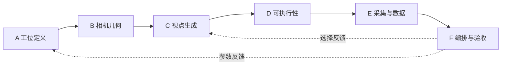

# 方案任务划分：子模块与子任务

把《视点规划技术调研 V1.1》的落地方案拆成**可独立开发、可独立验收**的子模块。
本文只做**划分**，不含详细设计与排期承诺。

- 规格来源：`视点规划技术调研V1.1.pdf`（23 页），页码为 PDF 页码
- 现状基线：提交 `63b5cfb`，`viewpoint_sim/` 共 1385 行，39 项测试
- 相关：条款级追溯见 `spec_traceability.md`，规格问题见 `spec_review.md`

---

## 1. 划分方法

三条切分线，同时生效：

| # | 切分线 | 依据 | 产出效果 |
|---|---|---|---|
| 1 | **按规格 §2 的三职责** | 规格明确推荐 ROI & Height Configuration / Random Viewpoint Planner / Robot Motion Executor | 与规格对齐，评审时能逐条对号 |
| 2 | **纯判据 / 带状态适配器分离** | 规格 §12 要求统计"几何通过率"，但几何判据当前埋在机器人循环里 | 几何层可脱离机器人单独跑、单独统计 |
| 3 | **按规格 §14 的五阶段** | 阶段1（静态几何验证）是唯一未交付的阶段 | 每个子模块有独立验收物，不被后续阶段阻塞 |

第 2 条是本次划分的关键：**规格 §2 的第二、三模块边界必须是"数据契约"边界，而不是"函数调用"边界**。否则 P1-b（分布统计）与 §12.1（采样有效率）永远做不出来。

---

## 2. 分层总览

规格的三个模块拆成 6 个子模块组：

| 规格模块（§2） | 子模块组 | 职责一句话 | 状态 |
|---|---|---|---|
| **ROI & Height Configuration** | **A 工位定义层** | 把物理工位变成可校验的约束对象 | 1 ✅ / 3 🟡 / 1 ⬜ |
| （规格未单列，散在 §3/§7） | **B 相机几何层** | 纯几何判据：入镜、量程、占比、裁剪 | 4 ✅ / 1 🟡 |
| **Random Viewpoint Planner** | **C 视点生成层** | 采样、朝向、多样性、选择策略 | 4 ✅ / 0 🟡 / 2 ⬜ |
| **Robot Motion Executor** | **D 可执行性层** | 模型、IK、碰撞、路径、执行 | 3 ✅ / 2 🟡 |
| （规格 §10/§7.6 的采集与保存） | **E 采集与数据层** | 传感、质检、落盘、重试 | 4 ✅ / 1 🟡 |
| （规格 §10/§12/§14 的流程与验收） | **F 编排与验收层** | 串接、统计、口径、回归 | 1 ✅ / 3 🟡 |

合计 **30 个子任务**：✅ 17、🟡 10、⬜ 3。

实线是数据流，虚线是**跨批次反馈**（拒绝原因 → 调参；统计结果 → 选择策略）。配置层不许反向调用执行层。

---

## 3. 子模块与子任务

状态图例：✅ 已落地 ｜ 🟡 部分落地 ｜ ⬜ 未实现

### A 工位定义层

职责：示教 → ROI / 托盘 / 外参 / 高度层 → 一份可校验的 `Workcell` 对象。
规格：§1.1、§1.2、§4、§5、§8.1、§11。

| ID | 子任务 | 内容 | 现状 | 优先级 |
|---|---|---|---|---|
| A1 | 示教探针链 | 探针 TCP 偏移校核；四角触碰 → `food_min_B/max_B`；`teach_timestamp` 落盘 | ⬜ | **P2-b** |
| A2 | ROI 对象模型 | Food ROI / Tray ROI / 最大食材高度 / 空间裕量；四个对象分别可配置 | 🟡 缺 `food_max_height_m` 独立键，裕量手工填 | P2 |
| A3 | 安装外参 T_FC | 尺寸估计 + **投影核验工具**（中心偏差、边界误差、稳定性、边距覆盖性四项指标） | 🟡 仅人工填 `camera.mount`，无核验 | **P2-a** |
| A4 | 高度层参数 | `h` 列表、`Δ`、**竖直单位向量 `g`**（非竖直工位必须显式配置） | 🟡 `h`/`Δ` 有，`g` 硬编码 `[0,0,-1]` | P1 |
| A5 | 配置装载与校验 | schema 校验、单位统一（m/rad）、场景几何硬关系、快照落盘 | ✅ | — |

> **A4 的必要性**：规格 §1.2(5) 自己要求"Base Z 非竖直时改用真实竖直向量"，但 §8.2/§11.1 的公式又写死 Base Z。先补 `g`，A 层才能对非竖直工位成立。

**验收**：给定一组示教四角与探针偏移，能产出与 `configs/default.json` 同构的 `roi` 段，并通过 A5 校验；外参核验工具能对一组位姿输出四项误差指标与"接受/拒绝"结论。

### B 相机几何层

职责：给一个相机位姿，判断"能不能拍、拍得好不好"。**纯函数，不碰仿真。**
规格：§3、§7。

| ID | 子任务 | 内容 | 现状 | 优先级 |
|---|---|---|---|---|
| B1 | 变换链与约定 | `T_A,B` 语义、`T_BC = T_BF·T_FC`、逆变换 | ✅ | — |
| B2 | 入镜判据 | 8 顶点投影、`z>0`、安全边距、RGB/Depth 双视场 | ✅（8 顶点充分性有实证） | — |
| B3 | 深度量程判据 | 整个扩张 ROI 的光学 Z 落在 `[z_near, z_far]` | ✅ | — |
| B4 | 烤盘占比 | 多边形求交；**归一化 `r̃ = r_tray / r_max(h)`**；硬阈值 + 软评分输入 | 🟡 硬阈值有（默认 0），无归一化、无评分 | **P1-a** |
| B5 | 裁剪派生 | 联合外接矩形、`K_crop`、独立 `crop_*` 产物 | ✅（默认关闭） | — |

> **B4 为什么必须归一化**：`r_tray ∝ 1/h²`，实测 200/240/280 mm 三层原始占比相差近 2 倍。归一化后落在 83–99.5%，单一常数阈值即可通用，直接消解规格 §13 那条"多高度阈值不可行"的风险。
>
> **B 层的输出是全流程唯一允许做"软评分"的地方**，且必须与硬约束结果分开返回，否则 C5 无法实现。

**验收**：B 层可对一批 `T_BC` 独立批处理，输出 `{ok, reason, metrics{...}}`，不依赖 `world`、不发 IK；归一化占比在三个高度上落在同一区间。

### C 视点生成层

职责：产生候选并挑出 N 个满足多样性的视点。**纯函数 + 随机流**。
规格：§6、§8.4。

| ID | 子任务 | 内容 | 现状 | 优先级 |
|---|---|---|---|---|
| C1 | XY / Z 采样器 | 独立随机流；`X~U`、`Y~U`；`Z = z_tray + h + δ`；Δ=0 不消耗随机数 | ✅ | — |
| C2 | Look-at 与退化规则 | `d/r/v` 构造；退化时取 `\|d\|` 最小的坐标基轴，`θ_eps` 由 0.98 定 | ✅ 规则已实现，仅缺文档 | P3 |
| C3 | 多样性门禁 | 光轴夹角去重、跨高度去重、实际位姿复验 | ✅ | — |
| C4 | 硬约束串接与归因 | 几何 → 去重 → IK → 碰撞 → 路径 → 到位复验；每个门禁返回具体原因 | ✅（去重前移，属更严） | — |
| C5 | 候选选择策略 | 收集 `M = ⌈ρN⌉`（**ρ=3**，`sampling.selection_over_collect_ratio`）个硬约束通过者，再按 `r̃` 选 top-N；阈值随高度归一化 | ⬜ 当前"先通过先接受" | **P1-a** |
| C6 | 分布统计 | 每视点方位角、倾角；按高度分组直方图；替代角度分层采样的质量反馈 | ⬜ 仅全局最小夹角 | **P1-b** |

> **C5 与 C6 是同一枚硬币**：规格 §6.3 反对分层采样，因此方位覆盖只能靠事后统计（C6）暴露；而 C5 若不实现，占比软约束完全是空转。两者应同批做。

**验收**：固定种子下 C 层输出与当前 8 视点逐位一致（C5 关闭时）；C5 打开后同种子输出可复现且 `r̃` 单调改善；C6 能给出每层的方位/倾角直方图。

### D 可执行性层

职责：把视点变成机械臂动作，并证明它安全。
规格：§9、§10.2。

| ID | 子任务 | 内容 | 现状 | 优先级 |
|---|---|---|---|---|
| D1 | 模型与 FK | URDF 解析、关节链、FK、与仿真 FK 互校 | ✅ | — |
| D2 | IK | 有界多初值、雅可比奇异判据、解去重与排序 | ✅ | — |
| D3 | 场景与碰撞模型 | 工位几何、凸包碰撞体、SRDF 豁免、局部豁免、环境/自碰撞 | ✅ | — |
| D4 | 路径规划与安全 | 直连优先、RRT-Connect、整段复核；**离散检测的隧穿界或 CCD** | 🟡 离散检查，无隧穿量化 | P2 |
| D5 | 执行与到位判据 | 运动学回放、到位 FK 误差、**"稳定"的量化判据** | 🟡 仿真无速度概念 | P2 |

**验收**：D 层对单个候选返回 `{q, path}` 或具体失败原因；D4 给出步长与最小障碍厚度的关系式，或改用 CCD；D5 给出真机可用的判据（速度阈值 + 持续时间 + 位姿残差）。

### E 采集与数据层

职责：渲染、验收、落盘、失败重试。
规格：§7.6、§10.1、§10.2。

| ID | 子任务 | 内容 | 现状 | 优先级 |
|---|---|---|---|---|
| E1 | 传感渲染 | RGB / 光学深度 / 实例 Mask；半像素对齐；隔离轮廓分母 | ✅ | — |
| E2 | 质量验收 | 可见率、深度有效率、最小像素数、最小包围盒边、是否被裁切 | ✅ | — |
| E3 | 落盘与自包含 | 元数据、`config.json` 快照、`candidates.jsonl`、manifest、平铺 RGB | ✅ | — |
| E4 | 失败与重试策略 | 同姿态重试 / 重采样 / 是否消耗配额 / 重试上限（规格 §10.2 未定义） | 🟡 当前一律重采样 | P2 |
| E5 | 可选裁剪产物 | `crop_*` 前缀、一致裁剪框、`K_crop` | ✅（缺 `scale` 记录，P3） | — |

**验收**：E 层输出可被 `scripts/verify_results.py` 独立复核通过；重试策略开关打开后，`summary.json` 能区分"一次通过/重试通过/重试耗尽"。

### F 编排与验收层

职责：串接、统计、口径、回归。
规格：§10、§12、§14。

| ID | 子任务 | 内容 | 现状 | 优先级 |
|---|---|---|---|---|
| F1 | 主流程编排 | 按 C→D→E 顺序驱动；**支持"只跑几何"模式**以便统计通过率 | 🟡 单循环交织 | **P1** |
| F2 | 统计汇总与报告 | `summary.json`、`views.json`、离线 HTML、高度对比 | ✅ | — |
| F3 | 验收指标口径 | 拆开"几何通过率（分母=全部候选）"与"实拍入镜率（分母=实际拍摄）"，修掉自指指标 | 🟡 存在自指 | **P1** |
| F4 | 负向工况与回归 | 五类不可能工况、独立导出复核、确定性复现 | 🟡 极值组合覆盖不足 | P2 |

> **F1 是 A2/B4/C6/F3 四件事的前置**：若不把几何判据从机器人循环里提出来，"几何通过率"这个分母根本拿不到。规格把这条指标列在 §12.1，但现有结构无法产出它。

**验收**：`run --geometry-only` 能只做 A→B→C 并输出通过率；`summary.json` 同时给出两种分母的指标；负向工况 5 类仍全为 0 有效。

---

## 4. 接口契约

子模块之间只通过下列数据交换，不许跨层调用：

| 边界 | 传递内容 | 约束 |
|---|---|---|
| A → B | `Workcell{roi, tray, camera, height_layer}` | 纯数据，无行为 |
| B → C | `Verdict{ok, reason, metrics}`；`metrics` 含 `tilt_deg`、`rz_min/max`、`tray_ratio`、`r_max`、`r_tilde` | **硬/软必须分开字段** |
| C → D | `Candidate{T_BC_target, T_BF_target, q_seed, height_index}` | 不含渲染结果 |
| D → E | `Execution{q_actual, T_BC_actual, path_q_rad, pe, re}` | 不含图像 |
| E → F | `Record{id, metrics, failures, paths}` | 与现有 `views.json` 同构 |
| F → A/C | `RejectionStats{reason: count}` | 只读统计，不许自动改配置 |

**C 层之后的三个"实际值"必须并存**：`T_BC_target`（几何）、`T_BC_actual`（FK）、`T_BC_measured`（真机读回）。当前只有前两个，第三个是接真机时的扩展点。

---

## 5. 与现有代码的映射

| 子模块 | 现有文件 | 建议动作 |
|---|---|---|
| A | `config.py`、`configs/default.json`、`assets/` | 保持；A1/A3 仅建空壳模块 `teach.py`、`calib.py`（签名 + `NotImplementedError`）并配文档 |
| B | `geometry.py`（133 行）、`planner.geometry_check` | **新建 `criteria.py`**，把 `geometry_check` 移出 `planner`；`geometry.py` 保持纯数学 |
| C | `planner.py` 的采样/朝向/去重部分 | 拆出 `sampling.py`、`diversity.py`、`selection.py`（C5，ρ=3） |
| D | `kinematics.py`、`motion.py`、`world.py` | 保持；`world.py` 只保留建模/碰撞/渲染三类职责；`motion.py` 补隧穿量化界注释 |
| E | `acquisition.py` | 保持；新增重试状态机 |
| F | `planner.run()`、`report.py`、`comparison.py`、`cli.py` | 拆出 `pipeline.py`；`report.py` 增加方位/倾角分布图 |

目标：`planner.py`（207 行）拆成 `sampling.py` + `criteria.py` + `pipeline.py` 后，单文件不再同时承担"判据 + 编排"。

---

## 6. 依赖与并行分工

| 批次 | 子任务 | 可并行度 | 说明 |
|---|---|---|---|
| **第 0 批（已完成）** | A5、B1–B3、B5、C1–C4、D1–D3、E1–E3、E5、F2 | — | 规格阶段 2、3 的骨架 |
| **第 1 批** | **F1** → F3、C6 | F1 必须先做 | 解耦后才能统计，统计才能暴露问题 |
| **第 2 批** | **C5** + **B4** | 可并行（B4 出 `r̃`，C5 消费） | P1-a，硬软两级占比 |
| **第 3 批** | **A4** → **A2** | 可并行 | A1/A3 已降级为"接口 + 文档"，不占代码工作量；A4 是 A 层剩余的唯一实质工作 |
| **第 4 批** | D5、E4、F4 | 全部可并行 | 消除实现分叉与安全盲区；D4 本轮只补量化界注释 |

**关键路径**：`F1（含 criteria.py 抽取）→ C6 → C5/B4`。A4 独立于这条路径，可与第 1–2 批并行。

---

## 7. 划分后的规模对照

| 子模块组 | 子任务数 | ✅ | 🟡 | ⬜ | 现有代码归属 |
|---|---:|---:|---:|---:|---|
| A 工位定义 | 5 | 1 | 3 | 1 | `config.py` 137 |
| B 相机几何 | 5 | 4 | 1 | 0 | `geometry.py` 133 + `planner` 片段 |
| C 视点生成 | 6 | 4 | 0 | 2 | `planner` 片段 |
| D 可执行性 | 5 | 3 | 2 | 0 | `kinematics` 90 + `motion` 78 + `world` 359 |
| E 采集与数据 | 5 | 4 | 1 | 0 | `acquisition.py` 155 |
| F 编排与验收 | 4 | 1 | 3 | 0 | `planner` 片段 + `report` 46 + `cli` 145 |
| **合计** | **30** | **17** | **10** | **3** | 1385 行 |

> A1/A3 降级为"接口 + 文档"后仍计为 ⬜，但不再产生代码工作量；本轮的 ⬜ 实际只剩 **A1、A3、C5、C6** 四项中的 A1/A3 为纯文档任务，C5/C6 为实作任务。

---

## 8. 已确认决策

| # | 议题 | 决策 | 影响 |
|---|---|---|---|
| 1 | B 层边界粒度 | **独立成 `criteria.py`** | 几何判据与机器人解耦，F1 的 `--geometry-only` 可落地；C6 的分母随之可得 |
| 2 | A 层（A1/A3）范围 | **只留接口与文档**，不在本仓库实现标定/示教流程 | 规格阶段 1 的验收由外部流程承担；仓库只提供 schema、校验与文档 |
| 3 | C5 超额收集倍数 | **ρ = 3**，写入 `sampling.selection_over_collect_ratio` | 硬约束通过者收集 `M = ⌈3N⌉` 个后按 `r̃` 选 N |
| 4 | D4 的连续碰撞检测 | **本轮不做** | 保留离散检查，改为补上隧穿量化界（`步长 × 包络半径 < 最小障碍厚度/2`）与文档警示 |

### 8.1 落地后的范围调整

| 子任务 | 原范围 | 调整后 | 交付物 |
|---|---|---|---|
| **A1** 示教探针链 | 实现四角 → ROI 构建 + TCP 校核 | **仅接口 + 文档** | `teach.py` 空壳签名（`roi_from_corners(...)` 抛 `NotImplementedError`）+ 示教流程与 TCP 校核说明 |
| **A3** 安装外参 | 实现四项投影核验指标 | **仅接口 + 文档** | `calib.py` 空壳签名（`verify_extrinsics(...)`）+ 四项指标定义与接受判据 |
| **D4** 路径安全 | 离散检查 + 可能引入 CCD | **仅离散 + 量化界** | `motion.py` 注释中的隧穿不等式 + 架构文档的局限说明（已有） |

A1/A3 状态保持 ⬜，但性质从"待开发"变为**规格符合性声明**：仓库预留接口，标定流程由外部工具承担。
